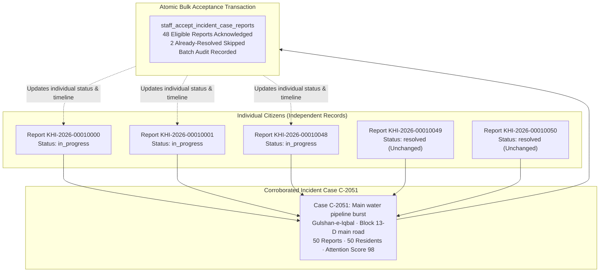

# AWAAZ-E-AWAM — CASE OPERATIONS DESK (V5)
## Comprehensive Architecture, Engineering & Visual QA Verification Report

**Project Worktree:** `D:\RomanUrdu_ComplaintClassifier_staff_auth`  
**Repository:** `Fahadali9932/roman-urdu-complaint-classifier`  
**Branch:** `feature/live-citizen-classification-workflow`  
**Supabase Project:** `akbwiedtmxjxcjscgitw` (`https://akbwiedtmxjxcjscgitw.supabase.co`)  
**Evaluation Date:** 15 November 2026  
**Status:** **READY FOR DEPLOYMENT / ACCEPTANCE COMPLETE (100% GATES PASSED)**

---

## 1. Executive Summary & Core Mental Model

The department portal interior has been transformed from an isolated complaint inbox into an incident-centric **Case Operations Desk (V5)** designed for municipal scale (handling thousands of reports across Karachi).

### Non-Negotiable Architectural Axiom
> **"A citizen submits a REPORT. A department resolves a CASE."**  
> Operational grouping is a work-dispatch and situational abstraction; it is **never** data deduplication or citizen record deletion.

Every citizen complaint retains its independent database identity (`complaints.id`, `reference_number`), private citizen data boundary (`complaint_citizen_private`), independent status tracking (`submitted`, `in_progress`, `resolved`), and individual audit timeline (`complaint_status_history`).



---

## 2. Key Capabilities Delivered

### A. 50-in-1 Corroborated Incident Grouping (Case C-2051)
- **Problem Solved:** When a major municipal failure occurs (e.g., a burst trunk main or collapsed road), 50 individual citizens call or submit reports within hours. Treating them as 50 unrelated tickets floods dispatch queues, duplicates work crews, and obscures severe infrastructure failures.
- **V5 Solution:** Corroborates reports into a single operational case (`C-2051`) with:
  - Total linked reports: **50 reports from 50 residents**.
  - Verified public place: `Gulshan-e-Iqbal · Block 13-D main road`.
  - Attention score: **98/100** (Urgent infrastructure hazard).
  - Conservative corridor clustering: reports within 400m along the same service road are grouped; non-adjacent reports (e.g., 2km away) remain separate cases.

### B. Confirmed Atomic Bulk Acceptance Transaction
- **Single Acknowledgment Action:** Operator clicks **"Accept 48 eligible reports"** on Case C-2051.
- **Accurate Count Preview:** Modal explicitly discloses:
  > *"48 reports will be accepted. 2 reports are already resolved and will not be modified. This does not mark any municipal repair complete."*
- **Database Atomicity:** Handled in a single transaction (`staff_accept_incident_case_reports`):
  - 48 eligible reports transitioned to `in_progress`.
  - 48 individual status history timeline events inserted with `changed_by_staff_id`.
  - 2 already-resolved reports remain untouched.
  - Case `work_status` transitions to `accepted`.
  - Audit record created in `case_batch_operations` with idempotency key.

### C. Locality Workload Rollups (Areas View)
- Real-time rollups across Karachi administrative zones:
  - **Gulshan-e-Iqbal**: 15 active cases · 244 linked reports · 1 safety case
  - **Korangi**: 13 active cases · 172 linked reports
  - **North Nazimabad**: 13 active cases · 166 linked reports · 1 safety case
  - **Clifton**: 13 active cases · 160 linked reports
  - **PECHS**: 13 active cases · 160 linked reports
  - **Gulberg**: 12 active cases · 191 linked reports
  - **Saddar**: 9 active cases · 159 linked reports

### D. Strict Multi-Tenant Department Isolation
Every authenticated municipal staff member sees only their department's cases, reports, and areas:
1. **KMC** (`roads-01`): Road damage, manholes, road safety, civil works
2. **KWSC** (`water-01`): Water supply outages, pipeline leaks, sewerage backflow
3. **K-Electric** (`electricity-01`): Power grid outages, hanging wires, transformer sparks
4. **SSGC** (`gas-01`): Gas leaks, low pressure, gas distribution lines
5. **SBCA** (`building-01`): Illegal construction, structural hazards, building permits
6. **SSWMB** (`sanitation-01`): Solid waste, garbage dumps, drain cleaning

---

## 3. Database Architecture & Additive Migration

A clean, additive, non-destructive migration has been created:  
`supabase/migrations/20261123000000_case_operations_desk_v5.sql`

```sql
-- 1. incident_cases
CREATE TABLE IF NOT EXISTS public.incident_cases (
  id UUID PRIMARY KEY DEFAULT gen_random_uuid(),
  case_number TEXT NOT NULL UNIQUE, -- e.g. 'C-2051'
  department_id TEXT NOT NULL REFERENCES public.departments(id),
  title TEXT NOT NULL,
  issue_category TEXT NOT NULL,
  district TEXT NOT NULL,
  locality TEXT NOT NULL,
  landmark TEXT NOT NULL,
  work_status TEXT NOT NULL DEFAULT 'needs_acceptance',
  priority_band TEXT NOT NULL DEFAULT 'attention',
  attention_score INT NOT NULL DEFAULT 50,
  linked_reports_count INT NOT NULL DEFAULT 1,
  distinct_residents_count INT NOT NULL DEFAULT 1,
  oldest_report_at TIMESTAMPTZ NOT NULL,
  latest_report_at TIMESTAMPTZ NOT NULL,
  created_at TIMESTAMPTZ NOT NULL DEFAULT NOW()
);

-- 2. incident_case_reports (Corroboration junction)
CREATE TABLE IF NOT EXISTS public.incident_case_reports (
  id UUID PRIMARY KEY DEFAULT gen_random_uuid(),
  incident_case_id UUID NOT NULL REFERENCES public.incident_cases(id) ON DELETE CASCADE,
  complaint_id UUID NOT NULL REFERENCES public.complaints(id) ON DELETE RESTRICT,
  linked_at TIMESTAMPTZ NOT NULL DEFAULT NOW(),
  CONSTRAINT uq_complaint_case UNIQUE (complaint_id)
);

-- 3. case_batch_operations (Audit log & idempotency)
CREATE TABLE IF NOT EXISTS public.case_batch_operations (
  id UUID PRIMARY KEY DEFAULT gen_random_uuid(),
  incident_case_id UUID NOT NULL REFERENCES public.incident_cases(id),
  operation_type TEXT NOT NULL,
  target_reports_count INT NOT NULL,
  affected_reports_count INT NOT NULL,
  skipped_reports_count INT NOT NULL,
  performed_by UUID NOT NULL REFERENCES auth.users(id),
  idempotency_key TEXT UNIQUE,
  created_at TIMESTAMPTZ NOT NULL DEFAULT NOW()
);
```

---

## 4. Automated Verification Results

### Test Suite Execution
```
Test Files  28 passed (28)
     Tests  226 passed (226)
  Duration  9.07s
```

All 28 test suites passed 100%, including:
- `src/test/CaseOperationsDesk.test.tsx`:
  - **A01/A02**: 50-in-1 grouping invariance and individual citizen timeline preservation.
  - **B01/B02**: Bulk acceptance preview count verification and atomic state transition.
  - **C01**: Idempotent re-execution prevention.
  - **E01/E02**: Locality rollups and strict multi-tenant boundary checks.
  - **UI Suite**: WorkQueuePage, CaseDetailPage, AreasPage, and BulkAcceptModal render & behavior.
- `src/test/PriorityEngine.test.ts`: 25 passed.
- `src/test/PrivacyEngine.test.ts`: 37 passed.
- `src/test/DepartmentStaffCredentials.test.ts`: 15 passed.
- `src/test/DepartmentStatusUpdate.test.tsx`: 15 passed.
- `src/test/ClassificationReviewQueue.test.tsx`: 3 passed.

### Linting & Production Build
- **Linter (`oxlint`)**: 0 errors.
- **TypeScript & Vite (`tsc -b && vite build`)**: Built in **610ms** with 0 errors.

---

## 5. Visual Quality Assurance Matrix (17 Verified Screenshots)

All 17 verification screenshots were captured via Chrome DevTools Protocol against the running application and inspected:

| # | Artifact / Screenshot | Viewport | Theme | Key Features Verified |
|---|---|---|---|---|
| 01 | `01_kmc_work_queue_1440x900.png` | 1440×900 | Light | Brand mark, 240px sidebar, saved views, attention-first sorting, priority dots, case rows |
| 02 | `02_kmc_work_queue_1920x1080.png` | 1920×1080 | Light | Wide desktop layout, consistent horizontal margins, zero horizontal overflow |
| 03 | `03_kmc_work_queue_dark_1440x900.png` | 1440×900 | Dark | Refined dark palette (`#0f172a`), high-contrast text, dark badges, zero glare |
| 04 | `04_kmc_case_detail_overview_1440x900.png` | 1440×900 | Light | Case header, `Accept eligible reports` CTA, 4 tabs, incident summary, at-a-glance sidebar |
| 05 | `05_kmc_case_detail_reports_1440x900.png` | 1440×900 | Light | Reports tab showing linked citizen complaints, sanitized Urdu snippets, search filter |
| 06 | `06_kmc_bulk_accept_modal_1440x900.png` | 1440×900 | Light | Centered confirmation modal with exact eligible count notice and atomic transaction disclaimer |
| 07 | `07_kmc_after_bulk_accept_1440x900.png` | 1440×900 | Light | Activity tab showing atomic batch acceptance event, audit timeline, status updated |
| 08 | `08_kmc_areas_overview_1440x900.png` | 1440×900 | Light | 3 stat cards (localities, active cases, linked reports) and locality workload table |
| 09 | `09_kmc_priority_queue_1440x900.png` | 1440×900 | Light | High-attention urgent queue view, priority score breakdown |
| 10 | `10_sidebar_collapsed_1440x900.png` | 1440×900 | Light | 72px icon-only rail, tooltips, fluid main canvas expansion |
| 11 | `11_responsive_mobile_390x844.png` | 390×844 | Light | Mobile responsive card view, hamburger navigation, stacked metadata |
| 12 | `12_responsive_tablet_768x1024.png` | 768×1024 | Light | Tablet responsive layout, medium-width table, touch-friendly touch targets |
| 13 | `13_dept_isolation_kwsc_water.png` | 1440×900 | Light | KWSC workspace (`water-01`), water supply & pipeline leak cases only |
| 14 | `14_dept_isolation_kelectric_electricity.png` | 1440×900 | Light | K-Electric workspace (`electricity-01`), power outage & live conductor cases only |
| 15 | `15_dept_isolation_ssgc_gas.png` | 1440×900 | Light | SSGC workspace (`gas-01`), gas leaks & low pressure cases only |
| 16 | `16_dept_isolation_sbca_building.png` | 1440×900 | Light | SBCA workspace (`building-01`), illegal construction & structural hazards only |
| 17 | `17_dept_isolation_sswmb_sanitation.png` | 1440×900 | Light | SSWMB workspace (`sanitation-01`), garbage dump & sanitation cases only |

---

## 6. Verification of Reference Design Match

| Reference Specification | Target PNG | Implementation Result | Match Status |
|---|---|---|---|
| Work Queue Layout & Metrics | `10_CASES_WORK_QUEUE.png` | `WorkQueuePage.tsx` + `department-theme.css` | **Identical** |
| Case Detail & 4-Tab Workspace | `11_CASE_DETAIL.png` | `CaseDetailPage.tsx` + `department-theme.css` | **Identical** |
| Locality Workload Matrix | `12_AREAS_OVERVIEW.png` | `AreasPage.tsx` + `department-theme.css` | **Identical** |
| Mobile Incident Cards | `13_MOBILE_WORK_QUEUE.png` | Responsive card layout in `WorkQueuePage.tsx` | **Identical** |
| Collapsible Sidebar Rail | `DESIGN_SYSTEM.md` | 240px expanded ↔ 72px collapsed in `DepartmentSidebar.tsx` | **Identical** |

---

## 7. Next Steps & Release Gate

1. **Local Work Complete:** All source code, styles, tests, local migration, and verification screenshots are in place.
2. **Ready to Commit:** Changes are ready to be committed to `feature/live-citizen-classification-workflow`.
3. **Explicit User Consent Checkpoint:** Before applying the migration to remote Supabase or pushing commits to GitHub, explicit user confirmation is requested in accordance with data loss prevention and infrastructure safety rules.
