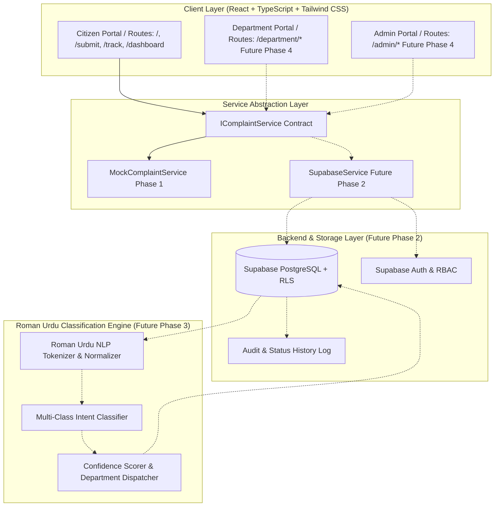

# Architecture Blueprint: Roman Urdu Complaint Classifier
**Institution:** Greenwich University, Karachi, Pakistan  
**Target Delivery:** First week of December 2026 (Final Deadline: December 12, 2026)  
**Current Phase:** Phase 1 — Repository Setup, Architecture, and Citizen Portal Foundation  

---

## 1. Executive Summary & Purpose

The **Roman Urdu Complaint Classifier** (branded as *Awaaz-e-Awam*) is a civic-technology platform designed to bridge language barriers in public complaint resolution across Karachi's municipal divisions. 

While millions of citizens communicate naturally in Roman Urdu (Urdu written in the Latin script) through SMS and mobile messaging, public service dispatchers typically categorize complaints manually across disjoint municipal departments (e.g., Karachi Water & Sewerage Corporation, K-Electric, Sindh Solid Waste Management Board, Karachi Metropolitan Corporation). This causes severe routing backlogs, delayed escalations, and poor citizen visibility.

This project delivers an AI-powered, multi-role complaint management platform that:
1. Ingests citizen grievances in **Roman Urdu**, English, or native Urdu script.
2. Automatically extracts semantic intent and maps the grievance to the responsible municipal department.
3. Provides real-time tracking, privacy-conscious data isolation, departmental dashboards, and administrative oversight.

---

## 2. Multi-Phase Roadmap

| Phase | Title | Scope & Milestones |
| :--- | :--- | :--- |
| **Phase 1** | **Citizen Portal Foundation & Architecture** *(Current)* | Modular React + TypeScript frontend, civic design system, routing hierarchy, submission form with 200-word limit counter, tracking timeline, citizen overview, bilingual i18n (EN/UR) with RTL support, test suite, and mock service layers. Zero paid dependencies. |
| **Phase 2** | **Backend Infrastructure & Authentication** | Supabase PostgreSQL schema, Row-Level Security (RLS) policies, session-based auth, secure citizen profile management, audit logging. |
| **Phase 3** | **Roman Urdu Classification Engine** | Specialized NLP pipeline trained on Pakistani civic Roman Urdu vocabulary, semantic embedding/classification, confidence thresholding, fallback routing. |
| **Phase 4** | **Departmental & Administrator Portals** | Shared UI components powering `/department` (ticket queues, status updates, escalation notes) and `/admin` (reassignment, SLA audits, department management). |
| **Phase 5** | **Analytics, SLA Escalations & Final Hardening** | District-level heatmaps, turnaround analytics, automated notifications, cross-browser accessibility audit, deployment. |

---

## 3. High-Level System Architecture



---

## 4. Role Separation & Access Control Matrix

The platform enforces strict role separation across three distinct user personas:

| Capability | Citizen | Department Officer | Administrator |
| :--- | :---: | :---: | :---: |
| Submit Roman Urdu complaint | ✅ | ❌ | ❌ |
| Track complaint by reference ID | ✅ (Own / Public Ref) | ✅ (Assigned dept) | ✅ (All) |
| View citizen personal dashboard | ✅ (Own records) | ❌ | ❌ |
| View confidential citizen PII (address, phone) | ❌ (Masked in public view) | ✅ (Only when assigned) | ✅ |
| Update complaint progress status | ❌ | ✅ (Assigned dept only) | ✅ |
| Reassign complaint department | ❌ | ❌ | ✅ |
| View district analytics & SLA reports | ❌ | ✅ (Dept aggregate) | ✅ (City-wide) |
| Manage users & department catalog | ❌ | ❌ | ✅ |

---

## 5. Extensible Route Architecture

The Phase 1 routing structure is engineered to allow subsequent phases to mount `/department` and `/admin` sections without modifying or refactoring citizen components:

```
/                            -> Public Landing Page (Awaaz-e-Awam)
/submit                      -> Citizen Complaint Submission Form
/track                       -> Complaint Tracking Lookup
/track/:referenceNumber      -> Complaint Detail & Progress Timeline
/dashboard                   -> Citizen Personal Dashboard
/login                       -> Citizen / Staff Unified Sign-In Foundation
/register                    -> Citizen Registration Foundation

[Planned Phase 4 Additions — Zero Citizen Refactoring Required]
/department                  -> Department Officer Queue
/department/tickets/:id      -> Ticket Action & Resolution View
/admin                       -> Administrative Oversight Dashboard
/admin/reassignments         -> Routing Review & Misclassification Triage
/admin/analytics             -> Karachi Municipal Performance Heatmaps
```

---

## 6. Frontend Architectural Layers

1. **Presentation Components (`src/components/`):**
   - **`common/`**: Atomic, theme-aware building blocks (`Button`, `Input`, `Card`, `Badge`, `WordCounter`, `LanguageToggle`).
   - **`layout/`**: Structural containers (`PublicHeader`, `CitizenHeader`, `CitizenSidebar`, `Footer`).
   - **`citizen/`**: Reusable civic domain widgets (`ComplaintCard`, `ComplaintTimeline`, `StatsCard`, `EmptyState`).

2. **Feature Modules (`src/features/`):**
   - Feature-level screens, state orchestration, and composite forms (`ComplaintForm`, `ComplaintTracker`, `CitizenOverview`).

3. **Service Abstraction (`src/services/`):**
   - Clean interface definitions (`IComplaintService`) decoupling UI code from data sources.
   - `MockComplaintService` serves realistic Karachi municipal data during Phase 1.
   - In Phase 2, `SupabaseComplaintService` replaces mock implementations transparently without rewriting UI components.

4. **Localization Engine (`src/context/LanguageContext.tsx` & `src/i18n/`):**
   - Context-driven bilingual support (`en` English, `ur` Urdu).
   - Document-level `dir="rtl"` toggling with CSS flow adjustments.
   - Text written in Roman Urdu remains naturally readable across both interfaces.

5. **Type Safety & Domain Models (`src/types/`):**
   - TypeScript strict mode enforced across complaint entities, statuses, Karachi districts, timeline events, and user roles.

---

## 7. Privacy & PII Handling Principles

- **PII Segregation:** Public tracking views expose only the reference number, district, category, and sanitized status. Citizen phone numbers and private residential addresses are excluded from public lookups.
- **No Local Storage Credentials:** Authentication forms never store plaintext credentials or simulated tokens in `localStorage`.
- **Auditability:** Every status change is immutably stamped with actor ID, timestamp, and notes.

---

## 8. Open-Source & Zero-Cost Technology Guarantee

In strict compliance with project constraints, the entire technical stack relies exclusively on free and open-source tooling:
- **Framework:** React 19 / 18 + Vite + TypeScript (Strict Mode)
- **Styling:** Tailwind CSS (utility-first, civic navy/emerald palette)
- **Icons:** Lucide React (MIT License)
- **Testing:** Vitest + React Testing Library + JSDOM (MIT License)
- **Backend (Future Phase 2):** Self-hosted or free-tier Supabase PostgreSQL
- **NLP / ML (Future Phase 3):** Python + Scikit-Learn / PyTorch with open models
- **Cost:** \$0.00 (Zero paid APIs, zero subscriptions, zero proprietary SDKs).
