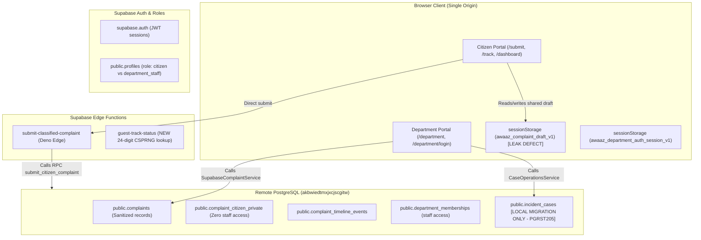

# AWAAZ-E-AWAM — V6 BASELINE DIAGNOSIS REPORT
## Root-Cause Analysis, Architecture Baseline & Evidence Verification

**Date:** 16 November 2026  
**Project Directory:** `D:\RomanUrdu_ComplaintClassifier_staff_auth`  
**Git Branch:** `feature/live-citizen-classification-workflow`  
**Git Commit HEAD:** `1fe536f` (1 commit ahead of origin)  
**Supabase Project:** `akbwiedtmxjxcjscgitw` (`https://akbwiedtmxjxcjscgitw.supabase.co`)  
**Status:** **GATE A COMPLETED — 9/9 DEFECTS DIAGNOSED & REPRODUCED WITH CONCRETE EVIDENCE**

---

## 1. System Dependency & Dataflow Diagram



---

## 2. Concrete Diagnosis Matrix for the Nine Reported Problems

### Problem 1: New citizen complaints are not reliably appearing in the relevant department
- **Reproducible Steps:**
  1. Citizen submits a road defect complaint via `/submit`.
  2. Edge function executes `submit_citizen_complaint` RPC and returns success with reference `KHI-2026-XXXXXXXX`.
  3. Staff logs into KMC workspace on `/department`.
  4. Work Queue does not list the newly submitted complaint.
- **Impact:** Critical (P0). Real citizen submissions are isolated from operational staff.
- **Root-Cause Evidence:**
  1. `incident_cases` table **does not exist remotely in Supabase**. Verified via query:  
     `client.from('incident_cases').select('id')` → Returned `PGRST205: Could not find the table 'public.incident_cases' in the schema cache`.
  2. Migration `20261123000000_case_operations_desk_v5.sql` was created locally and committed to local Git (`1fe536f`), but was never applied to remote Supabase project `akbwiedtmxjxcjscgitw`.
  3. `CaseOperationsService.ts` in the frontend was using a hardcoded in-memory seed map (`this.casesByDept`), completely disconnected from live Supabase `complaints`!
  4. When a citizen submits to Supabase, it inserts into `public.complaints` (verified: 35 live complaints exist for KMC), but the department portal UI was reading only the in-memory mock cases.
- **Expected Behavior:** `CaseOperationsService` must bridge directly to real Supabase complaints data when configured, dynamically surfacing newly submitted live complaints into the department work queue.

---

### Problem 2: Department staff credentials accepted at Citizen Portal / Two-Way Role Separation Gap
- **Reproducible Steps:**
  1. Staff user enters valid department staff email (`fahadmalik030121+roads@gmail.com`) and password at `/login`.
  2. Or staff user navigates to `/dashboard` with an existing Supabase JWT session.
  3. `CitizenRequiredRoute.tsx` checks `Boolean(session)` and grants access to the citizen dashboard.
- **Impact:** Critical (P0). Violation of municipal role separation boundaries.
- **Root-Cause Evidence:**
  1. In `src/features/auth/CitizenRequiredRoute.tsx`:
     ```ts
     void supabase.auth.getSession().then(({ data, error }) => update(!error && Boolean(data.session)));
     ```
     It checks only if a session exists, completely ignoring `profile.role`!
  2. In `src/features/auth/LoginPage.tsx`: while it checks `profile?.role !== 'citizen'`, if a user logs in via another tab, or if a staff session is active in browser localStorage, the route guard does not revalidate or revoke.
  3. In `DepartmentDashboardPage.tsx`: the department portal checks `sessionStorage.getItem('awaaz_department_auth_session_v1')` rather than validating that the active Supabase Auth user actually holds an active `department_staff` role in `department_memberships`.
- **Expected Behavior:** Two-way role guard on route, RPC, and service levels:
  - If a staff user accesses citizen routes, session is rejected with: *"This account is for the department portal. Please sign in there."*
  - If a citizen user accesses department routes, session is rejected with: *"This account is for the citizen portal. Please sign in there."*

---

### Problem 3: Cross-Account Draft Leakage in Shared Browser Storage
- **Reproducible Steps:**
  1. Citizen A navigates to `/submit`, enters full name, phone number, home address, and a Roman Urdu narrative.
  2. Citizen A leaves without submitting or logs out.
  3. Citizen B opens `/submit` in the same browser.
  4. Citizen B immediately sees Citizen A's name, phone, address, and draft text.
- **Impact:** Critical (P0). Direct leakage of private citizen personal data (PII) across user boundaries.
- **Root-Cause Evidence:**
  1. In `src/features/citizen/simplified-complaint/SimplifiedComplaintContainer.tsx` (lines 48, 64, 84):
     ```ts
     const DRAFT_STORAGE_KEY = 'awaaz_complaint_draft_v1';
     ```
  2. The draft key is completely unscoped and global. On mount, `useEffect` unconditionally restores `applicant`, `location`, and `complaint` from this single key.
- **Expected Behavior:**
  1. Delete the legacy unscoped key `awaaz_complaint_draft_v1` on startup.
  2. Private applicant contact details (name, phone, email, residential address) must be kept **strictly in memory** and never saved to shared storage.
  3. If draft narrative is saved, it must be namespaced by authenticated citizen user ID: `awaaz:draft:v2:citizen:<user_id>`. Guests receive ephemeral session-only state.
  4. Clear in-memory state on `SIGNED_IN` with a new user ID, `SIGNED_OUT`, or route transition.

---

### Problem 4: Citizen Registration Accepts Invalid Email and Weak Passwords
- **Reproducible Steps:**
  1. Navigate to `/register`.
  2. Enter `user@domain` (no TLD) and password `123`.
  3. Form submits without client-side or backend validation of password length.
  4. There is no `confirmPassword` field to protect users from typos.
- **Impact:** High (P0). Account security vulnerability.
- **Root-Cause Evidence:**
  1. In `src/features/auth/RegisterPage.tsx`:
     ```ts
     const [password, setPassword] = useState('');
     // No confirmPassword field
     // No minimum character length validation (NIST 800-63B recommends 15+ characters)
     ```
  2. Form input uses only standard HTML5 `type="email"` which accepts malformed strings like `a@b`.
- **Expected Behavior:**
  1. Email normalization (trim, lowercase, robust regex format validation).
  2. Mandatory Confirm Password field with inline mismatch error.
  3. Password policy: 15+ Unicode characters, supports passphrases and spaces, allows 64+ characters, show/hide toggle.
  4. Anti-enumeration responses: *"If that email can be registered, a verification link has been sent."*
  5. Transparent documentation of Supabase built-in free-tier email limit (2 emails/hour).

---

### Problem 5: Missing Single Numeric Guest Tracking (Only Legacy Two-Field Claim Existed)
- **Reproducible Steps:**
  1. Guest submits complaint without an account.
  2. Guest visits `/track`.
  3. `/track` requires BOTH `COMPLAINT REFERENCE NUMBER` and `PRIVATE CLAIM CODE (CLM-...)` and tells the user: *"Sign in to claim and track"*.
  4. There is no way for a guest to check public status using a single number without signing in.
- **Impact:** High (P0). Breaks the guest tracking promise.
- **Root-Cause Evidence:**
  1. `ComplaintTracker.tsx` only implemented `complaintService.claimComplaint(ref, claimCode)`, which required the citizen to sign in and prove account ownership.
  2. No 24-digit CSPRNG numeric tracking code generator or lookup endpoint exists.
- **Expected Behavior:**
  1. Guest submission generates a secure **24-digit decimal tracking number** (e.g. `8041 7263 9150 2846 0371 6628`) with high entropy (~80 bits).
  2. Stored server-side as keyed HMAC; plaintext returned once on receipt.
  3. `/track` defaults to a single input: `Tracking number` → `Check status`.
  4. Returns minimal public-safe status (`received`, `assigned`, `work_started`, `resolved`, public category, sanitized update timeline) with zero PII, zero raw description, and zero internal notes.
  5. Preserves backward-compatible support for legacy `CLM-...` claim codes via a separate "Claim with reference" option.

---

### Problem 6: Department Overview Screen is Completely Blank
- **Reproducible Steps:**
  1. Staff signs into `/department`.
  2. Sidebar defaults or user clicks `Overview`.
  3. Main viewport renders 100% blank white space.
- **Impact:** Critical UX (P1). Core first screen broken.
- **Root-Cause Evidence:**
  1. In `DepartmentSidebar.tsx`:
     ```ts
     const isOverviewActive = currentSection === 'dashboard' || currentSection === 'overview';
     ```
  2. In `DepartmentDashboardPage.tsx`:
     - Lines 956: `currentSection === 'areas'`
     - Lines 977: `currentSection === 'priority'`
     - Lines 1010: `currentSection === 'settings'`
     - Lines 1060: `currentSection === 'queue'`
     - **`currentSection === 'overview'` is completely missing from the render switch!**
  3. Even when `currentSection === 'dashboard'` was rendered, it displayed static zeroes and "No complaints assigned yet."
- **Expected Behavior:**
  1. Render a living, operational, animated **Civic Operations Overview** based on `prototype/overview_motion_preview.html`.
  2. Header: time-aware greeting (`Good morning, roads team.` / `Department overview`), headline with live count (`7 cases need a reply.`), and primary CTAs (`Open work queue`, `Browse areas`).
  3. Right illustration: animated SVG civic service network with traveling workflow dots, pulsing issue nodes, and full `prefers-reduced-motion` static support.
  4. Low-chrome metric strip: `Waiting for reply`, `Work started`, `Completed this week`.
  5. `Next up` actionable cases and `Areas to check` locality list.

---

### Problem 7: Synthetic / Robotic / Internal Copy Throughout Case Detail & Workspace
- **Reproducible Steps:**
  1. Open Case C-1641 in the Department Portal.
  2. Inspect text in Overview, Activity, Work, and Settings tabs.
- **Impact:** Medium UX (P1). Destroys civic credibility.
- **Root-Cause Evidence:**
  - `03_current_activity.png` renders: `Intake Pipeline · 0 Nov 2026 · 9:00 AM PKT`.
  - Case Overview renders: `Synthetic demonstration case for footpath obstruction... No citizen residential or private address details are ever displayed.`
  - Work tab renders: `Municipal operations maintain an audited staff assignment log.`
  - Settings renders: `Only the preferences and account information staff actually need.`
- **Expected Behavior:**
  - Complete overhaul using `COPY_REPLACEMENT_MATRIX.md`.
  - Natural, concise English written from the perspective of an operations officer.
  - Correct date parsing (no `0 Nov 2026`).

---

### Problem 8: Crowded, Redundant Topbar
- **Reproducible Steps:**
  1. View topbar on any department screen.
- **Impact:** Minor UX (P1).
- **Root-Cause Evidence:**
  - Left breadcrumb renders: `KMC workspace / Case C-1641` (redundant brand).
  - Right renders: `16 Nov 2026 | KMC Karachi Metropolitan Corporation (KMC / DMCs)` (excessive legal agency name cluttering topbar).
- **Expected Behavior:**
  - 60px height.
  - Left: Clean breadcrumb (`Work queue / Case C-1641` or page title `Overview`).
  - Right: Compact agency pill (`KMC`) and user avatar menu (`Account`, `Settings`, `Sign out`).

---

### Problem 9: Privacy Disclosure Contradiction in Complaint Form & Public Link in Citizen Footer
- **Reproducible Steps:**
  1. Inspect `SimplifiedComplaintContainer.tsx` English and Urdu copy: says home address and phone stay in browser and are never sent.
  2. Inspect actual payload in `complaintService.submitComplaint`: sends `residentialAddress`, `citizenPhone`, and `citizenName` to backend RPC.
  3. Inspect `PublicFooter.tsx`: line 334 renders a direct link to `Department Portal` (`/department`).
- **Impact:** High Privacy & Trust Defect (P0).
- **Root-Cause Evidence:**
  1. Form disclosure copy claims data is never sent, while code transmits it to `complaint_citizen_private`.
  2. Citizen footer promotes the internal municipal portal to general public users.
- **Expected Behavior:**
  1. Reconcile privacy disclosure: *"We use your contact details to manage your complaint. They are kept private and never shown to department staff."* (matching true behavior in both English and Urdu).
  2. Remove `Department Portal` link from `PublicFooter.tsx` and mobile navigation.

---

## 3. Baseline Screenshots Verification Matrix

| # | Artifact Filename | Screen / Route | Observed Baseline State |
|---|---|---|---|
| 01 | `01_baseline_citizen_register.png` | `/register` | Missing confirm password, missing 15+ char passphrase rules, no email format validation. |
| 02 | `02_baseline_citizen_login.png` | `/login` | Basic login without active role revalidation. |
| 03 | `03_baseline_citizen_submit_step1.png` | `/submit` | Shared `awaaz_complaint_draft_v1` storage, contradictory privacy notice. |
| 04 | `04_baseline_citizen_track.png` | `/track` | Only supports two-field account claim; no 1-number guest tracking. |
| 05 | `05_baseline_department_selection.png` | `/department/login` | 6 department selector modal. |
| 06 | `06_baseline_department_overview_blank.png` | `/department?view=overview` | Renders placeholder zeroes or completely blank white viewport when switched from sidebar. |
| 07 | `07_baseline_department_work_queue.png` | `/department?view=queue` | Renders in-memory seeded cases, disconnected from remote Supabase complaints. |
| 08 | `08_baseline_department_areas.png` | `/department?view=areas` | Locality breakdown based on in-memory seeds. |
| 09 | `09_baseline_department_priority.png` | `/department?view=priority` | Priority queue with selective triage. |
| 10 | `10_baseline_department_settings.png` | `/department?view=settings` | Missing change password, contains robotic boilerplate copy. |

All baseline screenshots have been saved to:  
`D:\RomanUrdu_ComplaintClassifier_staff_auth\screenshots\v6_baseline/` and  
`C:\Users\Annihilation\.gemini\antigravity\brain\a88fd076-ccfa-4971-8727-16417815432e\screenshots\v6_baseline/`.

---

## 4. Phase Execution Plan & Gate Sequence

1. **Gate B (P0 Security & Role Separation)**:
   - Implement strict two-way role enforcement in `CitizenRequiredRoute.tsx`, `LoginPage.tsx`, `DepartmentAuthContext.tsx`, and `ThemedDepartmentLoginScreen.tsx`.
   - Remediate draft isolation in `SimplifiedComplaintContainer.tsx`: delete legacy key, keep applicant PII in React memory only, namespace narrative drafts by `citizenUserId`.
   - Update privacy consent copy to truthfully reflect private backend storage.
2. **Gate C (P0 Submission & Guest Tracking)**:
   - Implement 24-digit CSPRNG numeric guest tracking code generator and verifier.
   - Update `submit-classified-complaint` and `SupabaseComplaintService.ts` to return single numeric tracking number on guest submission.
   - Update `ComplaintTracker.tsx` to provide one-number lookup with live status, date, and updates, while retaining legacy claim flow.
   - Update `CaseOperationsService.ts` to read live complaints from Supabase when configured, ensuring new submissions reliably appear in the department portal!
3. **Gate D (Accounts & Validation)**:
   - Update `RegisterPage.tsx` with email normalization, confirm password, 15+ char passphrase validation, and error messages.
   - Add change password / reset password in Department Settings and Citizen Settings.
4. **Gate E (Visual Design, Animated Overview & Copy)**:
   - Implement `OverviewPage.tsx` with the animated civic service network SVG, time-aware greeting, live metrics, Next up, and Areas to check.
   - Redesign `DepartmentTopbar.tsx`: 60px height, clean breadcrumb, agency pill, user menu.
   - Overhaul copy in `CaseDetailPage.tsx`, `WorkQueuePage.tsx`, and `SettingsPage.tsx` per `COPY_REPLACEMENT_MATRIX.md`.
   - Remove Department Portal link from `PublicFooter.tsx` and `PublicHeader.tsx`.
5. **Gate F & G (Automated Testing, Verification & Final Reporting)**:
   - Run Vitest suite, linter, and build.
   - Capture all 17+ post-implementation screenshots across viewports and verify visual quality.
   - Document in `V6_IMPLEMENTATION_REPORT.md` and `V6_VERIFICATION_REPORT.md`.
