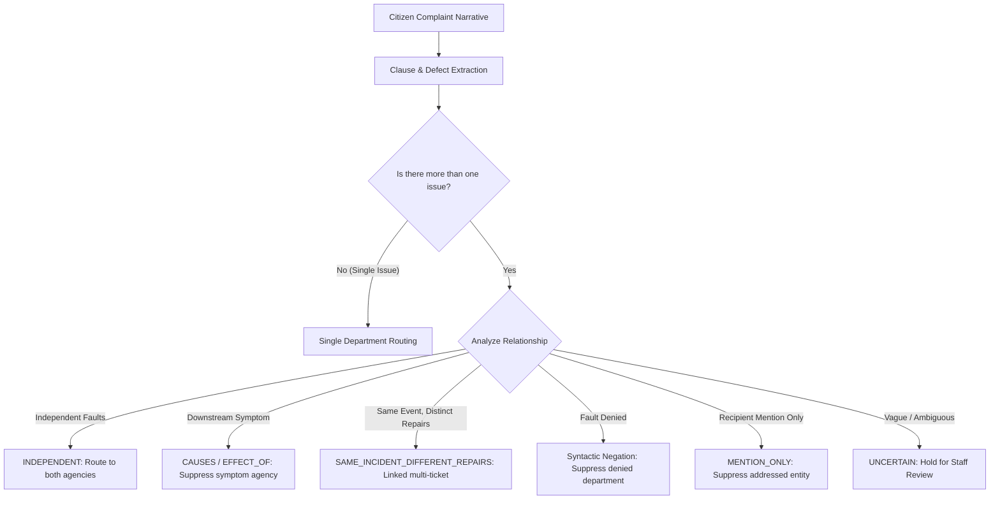

# AWAAZ-E-AWAM (آوازِ عوام) — PHASE V11
## 01. TAXONOMY AND CIVIC SCENARIO SPECIFICATION

**Document Version:** 1.0.0  
**Phase:** V11 — Isolated Zero-Cost Hybrid AI Training Factory  
**Scope:** Karachi Metropolitan Civic Services Taxonomy, Actionable Defect Catalog, and Causal Topology  

---

### 1. Executive Summary

In multi-label municipal complaint routing, the fundamental challenge is not merely mapping keywords to departments, but distinguishing **independently actionable public service problems** from:
1. Downstream non-actionable consequences (e.g. power outages preventing domestic water pumps from functioning).
2. Incident-level dual physical repairs (e.g. a burst main water pipe collapsing the road pavement).
3. Syntactic negations and boundary contrasts (e.g. asserting that the road is intact while complaining about an overflowing sewer).
4. Addressing municipal entities as conversational recipients rather than owners of the grievance (e.g. *"K-Electric wale please dekhen, asal masla gutter ka hai"*).

This specification details the human-maintained civic taxonomy, agency jurisdictional boundaries, and the catalog of 75 distinct scenario families implemented in `tools/ai_factory/scenarios/`.

---

### 2. The 6 Karachi Municipal Agencies & Jurisdictional Boundaries

| Canonical Key | Agency Name | Mandated Municipal Domain | Boundary & Jurisdictional Distinctions |
|---|---|---|---|
| `kmc` | **Karachi Metropolitan Corporation** | Primary public roads, major thoroughfares, arterial footpaths, civic flyovers, and major public storm-water drain infrastructure. | **Streetlights & Secondary Streets:** Municipal lighting infrastructure is operated under municipal street lighting circles rather than power distribution utilities. Local street paving can overlap with Union Committees / Town Municipal Administrations; classification assigns primary road repairs to KMC. |
| `kwsc` | **Karachi Water & Sewerage Corporation** | Piped public water mains, trunk water supply lines, municipal sewerage lines, overflowing public manholes, and public drainage blockages. | **Private Plumbing vs. Public Mains:** Domestic suction pumps, apartment overhead tank shortages, or internal pipe bursts are private civil matters. KWSC responsibility is strictly triggered by affirmative public infrastructure defects. |
| `kelectric` | **K-Electric** | Power generation, grid distribution, step-down transformers, overhead HT/LT electric lines, bare/snapped wires, voltage fluctuations, and billing meters. | **Appliance Consequences:** Domestic pump stoppage, air conditioning failure, or commercial refrigerator shutoffs due to blackouts are consequences of electrical outages, not secondary utility defects. |
| `ssgc` | **Sui Southern Gas Company** | Natural gas pipeline distribution, public gas mains, dangerous gas leaks, low gas pressure, and odorant detection. | **LPG Cylinder vs. Piped Gas:** Domestic LPG cylinder leaks or commercial cylinder fires fall under district emergency rescue (1122), while SSGC owns network pipeline infrastructure. |
| `sswmb` | **Sindh Solid Waste Management Board** | Public street sweeping, municipal garbage collection bins, roadside waste accumulation, dumper transit, and illegal garbage dumps. | **Drain Clogging:** Solid waste dumped into open drains triggers SSWMB for waste clearance, while structural drain repairs fall under municipal engineering. |
| `sbca` | **Sindh Building Control Authority** | Regulated building construction, structural integrity risks, hazardous cracks in multistory edifices, unauthorized floor additions, and illegal commercial extensions. | **Pavement Encroachments:** Roadside vendor kiosks fall under KMC anti-encroachment, whereas illegal structural building construction falls under SBCA. |

---

### 3. Causal & Semantic Relationship Contract

Every multi-issue complaint scenario is annotated with an explicit relational contract conforming to the V11 data specification:

#### Relation Classes:
1. `INDEPENDENT`: Two or more distinct physical defects existing simultaneously without causal linkage (e.g. `road_damage` [KMC] + `power_outage` [K-Electric]).
2. `CAUSES`: The primary defect directly induces an event (e.g. `power_outage` [K-Electric] causes domestic `water_motor_stop`). The downstream symptom is **non-actionable** and must NOT generate a secondary KWSC task.
3. `EFFECT_OF`: Inverse of `CAUSES`.
4. `SAME_INCIDENT_DIFFERENT_REPAIRS`: A single originating event causes physical structural damage requiring distinct repairs by two different agencies (e.g. a burst main water pipe erodes the road sub-base, collapsing the asphalt; requires KWSC pipe repair + KMC pavement reconstruction).
5. `MENTION_ONLY`: An entity is named as a greeting, salutation, or recipient without an affirmative grievance against its infrastructure (e.g. *"K-Electric wale dekhen..."*).
6. `UNCERTAIN`: Vague, speculative, or conjectural claims (e.g. *"shayad bijli ki wajah se pani band hai"*). Auto-routing is blocked; complaint is held under `needs_review:uncertain_defect`.

---

### 4. Scenario Catalog Breakdown (75 Typed Families)

The scenario catalog in `tools/ai_factory/scenarios/` is structured into 6 primary operational clusters:

1. **Single Agency Core Faults (45 Families):**
   - **KMC (10 Families):** Potholes, road sinkholes, cave-ins, open manholes on footpaths, broken curbs, flyover expansion joint damage, pedestrian bridge hazards, illegal road cuts, missing drain slabs, missing median barriers.
   - **KWSC (10 Families):** Total water supply cutoff, main trunk pipe burst, low water pressure, contaminated turbid water, sewage backflow into streets, missing sewer cover, water tanker hydrant extortion, industrial effluent in sewer, booster line leakage, burst air valve.
   - **K-Electric (10 Families):** Complete area blackout, transformer blowout/fire, fallen live electrical wire, low voltage / brownout, spark shower from pole, damaged electric meter, phase drop, hanging wire near school, recurring feeder trip, damaged sub-station door.
   - **SSGC (8 Families):** Zero natural gas supply, critically low gas pressure, public gas pipeline leak with odor, pipeline rupture from road construction, leaking consumer valve, gas compressor theft in area, gas pipeline water ingress, low pressure during cooking hours.
   - **SSWMB (8 Families):** Overflowing neighborhood garbage bins, uncollected waste for days, illegal commercial dumping on vacant plots, animal carcasses on public roads, burning garbage heaps with smoke, missing garbage bins, medical waste dumped in public alley, construction debris (malba) obstructing road.
   - **SBCA (8 Families):** Visible deep structural cracks in multistory residential building, unauthorized extra floor construction, demolition safety hazard without protective netting, dangerous tilted residential structure, illegal basement excavation destabilizing neighboring foundation, unauthorized commercial usage of residential plot, hazardous balcony collapse risk, structural column concrete spalling.

2. **Causal Consequence Scenarios (8 Families):**
   - Power blackout -> domestic water motor failure (K-Electric only; KWSC suppressed).
   - Sewer overflow -> vehicular traffic jam (KWSC only; KMC suppressed).
   - Low natural gas pressure -> citizen unable to cook food (SSGC only; no secondary agency).
   - Water supply cut -> reliance on expensive private water tankers (KWSC only).
   - Road excavation -> dust accumulation (KMC only).
   - Power outage -> commercial cold storage spoilage (K-Electric only).
   - Transformer explosion -> localized fire hazard (K-Electric priority safety).
   - Sewer flooding -> pedestrian footpath submerged (KWSC only).

3. **Same Incident Dual Repair Scenarios (6 Families):**
   - Water main burst collapses road asphalt (KWSC + KMC, `SAME_INCIDENT_DIFFERENT_REPAIRS`).
   - Road grading excavation cuts gas pipeline (KMC + SSGC, `SAME_INCIDENT_DIFFERENT_REPAIRS`).
   - Garbage heap clogging open stormwater drain (SSWMB + KMC, `SAME_INCIDENT_DIFFERENT_REPAIRS`).
   - Fallen live high-voltage wire submerged in sewage puddle (K-Electric + KWSC, `SAME_INCIDENT_DIFFERENT_REPAIRS` with dual hazard flags).
   - Heavy road roller hits and cracks exposed gas distribution valve (KMC + SSGC).
   - Deep illegal building excavation causes adjacent public road to slide (SBCA + KMC).

4. **Diverse Independent Agency Pairs (10 Families):**
   - Broken road pavement + Power blackout (KMC + K-Electric, `INDEPENDENT`).
   - Water supply cutoff + Low natural gas pressure (KWSC + SSGC, `INDEPENDENT`).
   - Uncollected garbage heap + Transformer blowout (SSWMB + K-Electric, `INDEPENDENT`).
   - Gas line leak + Exposed fallen electrical wire (SSGC + K-Electric, `INDEPENDENT`, dual hazards).
   - Overflowing sewer + Structural building crack (KWSC + SBCA, `INDEPENDENT`).
   - Road potholes + Missed garbage collection (KMC + SSWMB, `INDEPENDENT`).
   - Low water pressure + Power voltage drop (KWSC + K-Electric, `INDEPENDENT`).
   - Dangerous building construction + Low gas pressure (SBCA + SSGC, `INDEPENDENT`).
   - Road manhole open + Street garbage dump (KMC + SSWMB, `INDEPENDENT`).
   - Water supply loss + High-voltage wire spark (KWSC + K-Electric, `INDEPENDENT`).

5. **Negation & Boundary Contrast Scenarios (4 Families):**
   - Road intact, sewer overflowing (`"sarak bilkul theek hai magar gutter leak hai"` -> KWSC only, KMC negated).
   - Low gas pressure asserted, gas leak denied (`"gas leak nahi hai sirf pressure kam hai"` -> SSGC pressure only, no leak hazard).
   - Electrical wire safe, road broken (`"wire bilkul theek hai road par khadday hain"` -> KMC only, K-Electric negated).
   - Solid waste clean, open manhole present (`"kachra nahi hai lekin manhole khula hai"` -> KMC only, SSWMB negated).

6. **Ambiguous & Review Scenarios (2 Families):**
   - Generic complaint without department evidence (`"har taraf maslay hain koi sunwai nahi"` -> `expected_route="review"`).
   - Speculative causal guess (`"pani band hai shayad bijli ki wajah se?"` -> `expected_route="review"`).

---

### 5. Karachi Linguistic Variance & Localities

To reflect genuine citizen submissions, complaints are generated using authentic variations across:
- **20+ Authentic Localities:** Saddar Preedy Street, Gulshan Block 13-D, Korangi Industrial Area, North Nazimabad Block H, Clifton Block 2, Orangi Town Sector 11-L, Lyari Cheel Chowk, Malir City, Federal B Area Block 14, PECHS Block 6, Landhi Babar Market, Nazimabad No. 7, Keamari Dockyard, Shah Faisal Colony No. 3, Baldia Town Chandni Chowk, Gulberg Block 8, Defence Phase 2, Liaquatabad Supermarket, SITE Area Metroville, Gulistan-e-Jauhar Block 15.
- **Linguistic Noise & Transliteration Variants:** Selective stochastic variation for high-frequency words:
  `bohat` / `bohot` / `bht`; `kharab` / `khrab` / `khrb`; `sarak` / `sadak` / `road`; `pani` / `paani`; `bijli` / `bijlee` / `light`; `gutter` / `gatar`; `kachra` / `kachray` / `garbage`; `theek` / `thik`; `nahi` / `nhi` / `nai`; `hai` / `he`; `mein` / `me` / `mai`.
- **Narrative Length Distribution:** 20% Short (5–15 words), 60% Standard (20–40 words), 20% Long multi-clause narratives (50–100 words with community impact context).
