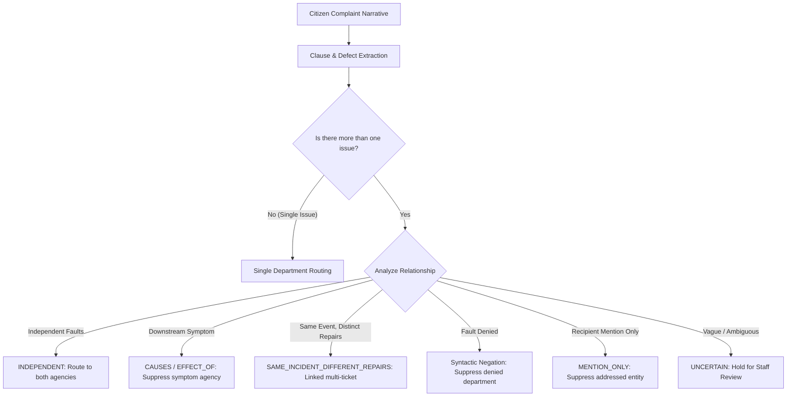

# AWAAZ-E-AWAM (آوازِ عوام) — PHASE V11
## 01. TAXONOMY AND CIVIC SCENARIO SPECIFICATION

**Document Version:** 1.0.0  
**Phase:** V11 — Isolated Zero-Cost Hybrid AI Training Factory  
**Scope:** Karachi Metropolitan Civic Services Taxonomy, Actionable Defect Catalog, and Causal Topology  

---

### 1. Executive Summary

In multi-label municipal complaint routing, the fundamental challenge is not merely mapping keywords to departments, but distinguishing **independently actionable public service problems** from:
1. Downstream non-actionable consequences (e.g. power outages preventing domestic water pumps from functioning).
2. Incident-level dual physical repairs (e.g. a burst main water pipe collapsing the road pavement).
3. Syntactic negations and boundary contrasts (e.g. asserting that the road is intact while complaining about an overflowing sewer).
4. Addressing municipal entities as conversational recipients rather than owners of the grievance (e.g. *"K-Electric wale please dekhen, asal masla gutter ka hai"*).

This specification details the human-maintained civic taxonomy, agency jurisdictional boundaries, and the catalog of 75 distinct scenario families implemented in `tools/ai_factory/scenarios/`.

---

### 2. The 6 Karachi Municipal Agencies & Jurisdictional Boundaries

| Canonical Key | Agency Name | Mandated Municipal Domain | Boundary & Jurisdictional Distinctions |
|---|---|---|---|
| `kmc` | **Karachi Metropolitan Corporation** | Primary public roads, major thoroughfares, arterial footpaths, civic flyovers, and major public storm-water drain infrastructure. | **Streetlights & Secondary Streets:** Municipal lighting infrastructure is operated under municipal street lighting circles rather than power distribution utilities. Local street paving can overlap with Union Committees / Town Municipal Administrations; classification assigns primary road repairs to KMC. |
| `kwsc` | **Karachi Water & Sewerage Corporation** | Piped public water mains, trunk water supply lines, municipal sewerage lines, overflowing public manholes, and public drainage blockages. | **Private Plumbing vs. Public Mains:** Domestic suction pumps, apartment overhead tank shortages, or internal pipe bursts are private civil matters. KWSC responsibility is strictly triggered by affirmative public infrastructure defects. |
| `kelectric` | **K-Electric** | Power generation, grid distribution, step-down transformers, overhead HT/LT electric lines, bare/snapped wires, voltage fluctuations, and billing meters. | **Appliance Consequences:** Domestic pump stoppage, air conditioning failure, or commercial refrigerator shutoffs due to blackouts are consequences of electrical outages, not secondary utility defects. |
| `ssgc` | **Sui Southern Gas Company** | Natural gas pipeline distribution, public gas mains, dangerous gas leaks, low gas pressure, and odorant detection. | **LPG Cylinder vs. Piped Gas:** Domestic LPG cylinder leaks or commercial cylinder fires fall under district emergency rescue (1122), while SSGC owns network pipeline infrastructure. |
| `sswmb` | **Sindh Solid Waste Management Board** | Public street sweeping, municipal garbage collection bins, roadside waste accumulation, dumper transit, and illegal garbage dumps. | **Drain Clogging:** Solid waste dumped into open drains triggers SSWMB for waste clearance, while structural drain repairs fall under municipal engineering. |
| `sbca` | **Sindh Building Control Authority** | Regulated building construction, structural integrity risks, hazardous cracks in multistory edifices, unauthorized floor additions, and illegal commercial extensions. | **Pavement Encroachments:** Roadside vendor kiosks fall under KMC anti-encroachment, whereas illegal structural building construction falls under SBCA. |

---

### 3. Causal & Semantic Relationship Contract

Every multi-issue complaint scenario is annotated with an explicit relational contract conforming to the V11 data specification:

#### Relation Classes:
1. `INDEPENDENT`: Two or more distinct physical defects existing simultaneously without causal linkage (e.g. `road_damage` [KMC] + `power_outage` [K-Electric]).
2. `CAUSES`: The primary defect directly induces an event (e.g. `power_outage` [K-Electric] causes domestic `water_motor_stop`). The downstream symptom is **non-actionable** and must NOT generate a secondary KWSC task.
3. `EFFECT_OF`: Inverse of `CAUSES`.
4. `SAME_INCIDENT_DIFFERENT_REPAIRS`: A single originating event causes physical structural damage requiring distinct repairs by two different agencies (e.g. a burst main water pipe erodes the road sub-base, collapsing the asphalt; requires KWSC pipe repair + KMC pavement reconstruction).
5. `MENTION_ONLY`: An entity is named as a greeting, salutation, or recipient without an affirmative grievance against its infrastructure (e.g. *"K-Electric wale dekhen..."*).
6. `UNCERTAIN`: Vague, speculative, or conjectural claims (e.g. *"shayad bijli ki wajah se pani band hai"*). Auto-routing is blocked; complaint is held under `needs_review:uncertain_defect`.

---

### 4. Scenario Catalog Breakdown (75 Typed Families)

The scenario catalog in `tools/ai_factory/scenarios/` is structured into 6 primary operational clusters totaling exactly 75 scenario families:

1. **Single Agency Core Faults (54 Families):**
   - **KMC (10 Families):** Potholes (`kmc_potholes_asphalt`), sinkholes (`kmc_sinkhole_collapse`), footpath encroachments (`kmc_footpath_encroachment`), storm drain clogged (`kmc_storm_drain_clogged`), bridge expansion joint (`kmc_bridge_expansion_joint`), damaged median divider (`kmc_divider_damaged`), missing manhole cover on footpath (`kmc_manhole_cover_missing`), streetlights out (`kmc_street_lights_out`), unauthorized speed breaker (`kmc_speed_breaker_unauthorized`), road flooded in monsoon (`kmc_road_flooded_monsoon`).
   - **KWSC (10 Families):** Water shortage (`kwsc_water_supply_shortage`), pipe burst leak (`kwsc_pipe_burst_leak`), low water pressure (`kwsc_low_water_pressure`), sewer overflow foul odor (`kwsc_sewer_overflow_foul`), contaminated water mix (`kwsc_water_contamination_mix`), missing sewer lid (`kwsc_missing_sewer_lid`), tanker mafia suction (`kwsc_tanker_mafia_suction`), submerged road sewer (`kwsc_submerged_road_sewer`), broken distribution valve (`kwsc_valve_broken`), clogged drainage manhole (`kwsc_clogged_drainage_manhole`).
   - **K-Electric (10 Families):** Complete power outage (`ke_power_outage_blackout`), transformer burn/spark (`ke_transformer_burn_spark`), fallen live wire hazard (`ke_live_wire_fallen_hazard`), low voltage fluctuation (`ke_low_voltage_fluctuation`), dangerous leaning pole (`ke_pole_leaning_dangerous`), loose service cable (`ke_loose_service_cable`), meter sparking (`ke_meter_sparking`), frequent feeder tripping (`ke_feeder_tripping_frequent`), missing phase (`ke_phase_missing`), underground cable fault (`ke_underground_cable_fault`).
   - **SSGC (8 Families):** Gas supply loss (`ssgc_gas_supply_loss`), low gas pressure (`ssgc_low_gas_pressure`), pipeline leak odor hazard (`ssgc_pipeline_leak_odor_hazard`), meter joint leak (`ssgc_meter_joint_leak`), compressor theft (`ssgc_compressor_theft`), pipeline fracture during excavation (`ssgc_pipeline_fracture_excavation`), broken gas valve (`ssgc_gas_valve_broken`), cooking hour timing shortage (`ssgc_timing_shortage`).
   - **SSWMB (8 Families):** Overflowing garbage dump (`sswmb_garbage_overflow_dump`), missed garbage collection (`sswmb_missed_collection`), urgent animal carcass (`sswmb_animal_carcass_urgent`), street sweeping neglect (`sswmb_sweeping_neglect`), hospital clinical waste dumped (`sswmb_hospital_waste_dumped`), drain bank dumping (`sswmb_drain_bank_dumping`), commercial market waste (`sswmb_commercial_market_waste`), burning garbage smoke (`sswmb_burning_garbage_smoke`).
   - **SBCA (8 Families):** Illegal extra floors (`sbca_illegal_extra_floors`), dangerous cracked building (`sbca_dangerous_cracked_building`), illegal commercial conversion (`sbca_illegal_commercial_conversion`), hazardous balcony overhang (`sbca_hazardous_balcony_overhang`), illegal basement excavation (`sbca_illegal_basement_excavation` — restored in V11.2A), unauthorized extension onto street (`sbca_unauthorized_extension_street`), sealing order violation (`sbca_sealing_order_violation`), falling concrete debris (`sbca_falling_concrete_debris`).

2. **Causal Consequence Scenarios (4 Families):**
   - Power blackout -> domestic water motor failure (`causal_power_motor_kwsc_suppressed` -> K-Electric only; KWSC suppressed).
   - Sewer overflow -> vehicular traffic jam (`causal_sewage_traffic_kmc_suppressed` -> KWSC only; KMC suppressed).
   - Low natural gas pressure -> cooking symptom (`causal_low_gas_cooking_symptom` -> SSGC only).
   - Water supply cut -> tanker reliance (`causal_water_outage_tanker_reliance` -> KWSC only).

3. **Syntactic Negation & Boundary Contrast Scenarios (5 Families):**
   - Road intact, sewer overflowing (`negation_road_fine_sewer_broken` -> KWSC only, KMC negated).
   - Gas leak denied, low pressure affirmed (`negation_gas_leak_denied_low_pressure` -> SSGC pressure only, no leak hazard).
   - Electrical wire safe, road broken (`negation_wire_safe_pothole_reported` -> KMC only, K-Electric negated).
   - Drain area clean of waste, drain structurally clogged (`negation_waste_drain_clean` -> KMC only, SSWMB negated).
   - Building structurally sound, illegal extra floor (`negation_building_solid_illegal_floor` -> SBCA only).

4. **Same Incident Dual Repair Scenarios (4 Families):**
   - Water main burst collapses road asphalt (`dual_water_burst_road_collapsed` -> KWSC + KMC, `SAME_INCIDENT_DIFFERENT_REPAIRS`).
   - Road excavation cuts gas pipeline (`dual_excavation_gas_leak` -> KMC + SSGC, `SAME_INCIDENT_DIFFERENT_REPAIRS`).
   - Garbage heap clogging open stormwater drain (`dual_garbage_clogged_storm_drain` -> SSWMB + KMC, `SAME_INCIDENT_DIFFERENT_REPAIRS`).
   - Fallen live high-voltage wire submerged in sewage puddle (`dual_submerged_live_wire_sewage` -> K-Electric + KWSC, dual hazards).

5. **Diverse Independent Agency Pairs (6 Families):**
   - Broken road pavement + Power blackout (`indep_road_damage_power_outage` -> KMC + K-Electric, `INDEPENDENT`).
   - Water supply cutoff + Low natural gas pressure (`indep_water_cutoff_low_gas` -> KWSC + SSGC, `INDEPENDENT`).
   - Uncollected garbage heap + Transformer blowout (`indep_garbage_heap_transformer_burn` -> SSWMB + K-Electric, `INDEPENDENT`).
   - Gas line leak + Exposed fallen electrical wire (`indep_gas_leak_live_wire` -> SSGC + K-Electric, `INDEPENDENT`, dual hazards).
   - Overflowing sewer + Structural building crack (`indep_overflowing_sewer_building_crack` -> KWSC + SBCA, `INDEPENDENT`).
   - Road potholes + Missed garbage collection (`indep_road_potholes_missed_garbage` -> KMC + SSWMB, `INDEPENDENT`).

6. **Ambiguous & Review Scenarios (2 Families):**
   - Speculative causal guess (`uncertain_cause_speculation` -> `expected_route="review"`).
   - Generic complaint without department evidence (`vague_complaint_no_service_detail` -> `expected_route="review"`).

**Scenario Arithmetic Summary:**  
`54 (Core) + 4 (Causal) + 5 (Negation) + 4 (Dual Repair) + 6 (Independent) + 2 (Review) = 75 Total Scenario Families.`

---

### 5. Karachi Linguistic Variance & Localities

To reflect genuine citizen submissions, complaints are generated using authentic variations across:
- **20+ Authentic Localities:** Saddar Preedy Street, Gulshan Block 13-D, Korangi Industrial Area, North Nazimabad Block H, Clifton Block 2, Orangi Town Sector 11-L, Lyari Cheel Chowk, Malir City, Federal B Area Block 14, PECHS Block 6, Landhi Babar Market, Nazimabad No. 7, Keamari Dockyard, Shah Faisal Colony No. 3, Baldia Town Chandni Chowk, Gulberg Block 8, Defence Phase 2, Liaquatabad Supermarket, SITE Area Metroville, Gulistan-e-Jauhar Block 15.
- **Linguistic Noise & Transliteration Variants:** Selective stochastic variation for high-frequency words:
  `bohat` / `bohot` / `bht`; `kharab` / `khrab` / `khrb`; `sarak` / `sadak` / `road`; `pani` / `paani`; `bijli` / `bijlee` / `light`; `gutter` / `gatar`; `kachra` / `kachray` / `garbage`; `theek` / `thik`; `nahi` / `nhi` / `nai`; `hai` / `he`; `mein` / `me` / `mai`.
- **Narrative Length Distribution:** 20% Short (5–15 words), 60% Standard (20–40 words), 20% Long multi-clause narratives (50–100 words with community impact context).

---

### 6. Evaluation Corpus Provenance & Historical Developer Fixtures

> [!IMPORTANT]
> The 33 evaluation records in `data/v11/splits/human_gold.jsonl` are **historical developer-authored unit test fixtures** originally created during Phases V9 and V10 to test edge cases, multi-department routing, and regex logic.
>
> They are **NOT** independently verified real citizen complaints collected from live municipal intake channels. They must not be described as a fresh locked human-gold benchmark, nor used to claim >90% real-world citizen accuracy. In Phase V11.2B, an authentic, double-annotated citizen corpus will be collected following strict human-in-the-loop review governance.
