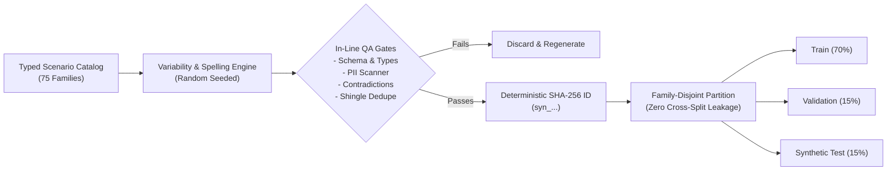

# AWAAZ-E-AWAM (آوازِ عوام) — PHASE V11
## 02. DATASET GENERATION, QA GATES, AND GOVERNANCE REPORT

**Document Version:** 1.0.0  
**Phase:** V11 — Isolated Zero-Cost Hybrid AI Training Factory  
**Execution Timestamp:** 2026-11-16  
**Hardware & Environment:** Windows, Python 3.14.5 (No paid APIs, $0.00 spend)  

---

### 1. Generation Architecture & Provenance Contract

The Hybrid AI Training Factory (`tools/ai_factory/`) is an offline, zero-mutation data engine designed to produce high-fidelity Roman Urdu municipal complaint corpora derived strictly from **hand-authored typed scenario truth**.



#### Strict Provenance Metadata:
Every synthetic record generated by the factory is tagged with immutable provenance fields:
- `source_kind: "synthetic_factory"`
- `label_origin: "scenario_spec"`
- `review_status: "unreviewed"`
- `is_gold: false`
- `generator_version: "v11-factory-1"`
- `seed: <integer>`
- `record_id: "syn_<sha256_prefix>"`

**Anti-Gold Claim Rule:** Any record where `source_kind == "synthetic_factory"` and `is_gold == true` is rejected outright by the validator as forged provenance.

---

### 2. Quality Assurance Gates Audit

The factory incorporates 4 deterministic QA gates executed both in-line during generation and as an independent batch verification step:

#### 1. Privacy & PII Scanner
Screens every text against regular expression and context patterns before storage:
- **Pakistani Mobile Numbers:** `(?<!\d)(?:\+?92[- ]?)?0?3\d{2}[- ]?\d{7}(?!\d)`, `\b03\d{2}[- ]?\d{7}\b`
- **Karachi Landlines:** `\b021[- ]?\d{7,8}\b`
- **Pakistani CNIC:** `(?<!\d)\d{5}-?\d{7}-?\d(?!\d)`
- **Email Addresses:** RFC-5322 subset (`[A-Za-z0-9._%+-]+@[A-Za-z0-9.-]+\.[A-Za-z]{2,}`)
- **API Keys / Auth Tokens:** JWT headers (`ey...`), GitHub personal tokens (`ghp_...`), OpenAI style keys (`sk-...`)
- **Private Residential Identifiers:** House numbers, flat numbers, plot addresses (`House 14-B`, `Plot B-45`, `Flat 302`)

*Audit Result:* 1,200 generated synthetic records scanned; **0 PII violations found**.

#### 2. Syntactic Negation & Contradiction Checker
Civic complaints in Roman Urdu distinguish between **outage affirmations** and **fault negations**:
- `"bijli nahi aa rahi"` or `"pani nahi hai"` = **Affirmative outage** (valid actionable issue).
- `"sarak bilkul theek hai"` or `"gas leak nahi hai"` = **Defect denial** (negated fault).

The validator cross-checks text denials against the assigned issues:
- If `"sarak theek hai"` or `"koi khadda nahi"` appears, assigning `kmc` or `road_damage` triggers a `ContradictionError`.
- If `"gas leak nahi hai"` appears, assigning `ssgc` with `gas_leak` triggers a `ContradictionError`.
- If `"kachra nahi hai"` appears, assigning `sswmb` triggers a `ContradictionError`.

*Audit Result:* All 75 scenario families audited; **0 contradictions detected**.

#### 3. Character 4-gram Shingle Deduplication
To prevent synthetic near-duplicate leakage, complaints are converted into sets of lowercase 4-character shingles:
$$\text{Jaccard}(S_1, S_2) = \frac{|S_1 \cap S_2|}{|S_1 \cup S_2|}$$
Pairs across different families exceeding the similarity threshold of 0.88 are flagged as cross-family leakage.

*Audit Result:* Intra-batch text uniqueness: **100.0%**. Cross-family shingle leakage: **0 pairs exceeding 0.88**.

---

### 3. Split Partitioning & Leakage Analysis

To prevent data leakage, dataset splitting is executed strictly on **disjoint scenario families** (`family_id`), not by random row sampling. All syntactic and narrative variations of a specific fault family reside in exactly one partition.

> [!NOTE]
> **V11.2A Resolution of the 74 vs 75 Family Count Discrepancy:**
> In the initial V11 generation run, 74 unique families were produced instead of 75 because scenario `sbca_illegal_basement_excavation` contained the Roman Urdu word `makanon` (*"sath walay makanon ki bunyad"*), which was mistakenly matched by the aggressive residential address regex `\b(?:house|makan|plot)\b.*`.
> In Phase V11.2A, the regex was updated to `\b(?:house|hno|h\.no|makan|flat|banglow|bungalow|plot|apartment|apt)\b\s*(?:(?:no\.?|number|#)\s*[a-z0-9\-/]+|\s+[a-z0-9\-/]*\d[a-z0-9\-/]*)\b|\b(?:h#|flat#|plot#|apt#)\s*[a-z0-9\-/]+\b`. All 75 scenario families now generate cleanly without false PII drops.

```
Initial Baseline Generation:
Total Generated Records: 1,200
Total Catalog Families:   75 (74 generated in initial V11 split, 75 restored in V11.2A)
Random Seed:             42
```

| Partition | Total Records | Unique Families | Multi-Issue Rows | Review Rows | KMC | KWSC | K-Electric | SSGC | SSWMB | SBCA |
|---|---:|---:|---:|---:|---:|---:|---:|---:|---:|---:|
| **Train** | 844 (70.3%) | 51 (68.9%) | 79 | 14 | 200 | 248 | 124 | 136 | 104 | 97 |
| **Validation** | 186 (15.5%) | 11 (14.9%) | 29 | 19 | 36 | 40 | 29 | 33 | 46 | 12 |
| **Synthetic Test** | 170 (14.2%) | 12 (16.2%) | 40 | 0 | 32 | 11 | 68 | 38 | 41 | 20 |

#### Cross-Split Leakage Verification:
- `Train ∩ Validation Families`: **0 (Ø)**
- `Train ∩ Test Families`: **0 (Ø)**
- `Validation ∩ Test Families`: **0 (Ø)**
- `Leakage Detected`: **False (0.00%)**

---

### 4. Evaluation Set Provenance: Historical Developer Fixtures

> [!WARNING]
> **Provenance Rectification:**
> The 33 records stored in `data/v11/splits/human_gold.jsonl` are **historical developer-authored unit test fixtures** originally created during Phases V9 and V10 to test edge cases, multi-department routing, and regex logic.
>
> They are **NOT** independently verified real citizen complaints collected from live municipal intake archives.
>
> In the Phase V11.1 audit, these 33 fixtures were found to be:
> 1. Developer-authored phrases (e.g. *"humare ghar ke pass wali road bohot zada kharab hoi v hai isko theek kiya jae"*).
> 2. Historically recycled across V9, V10, and V11 test matrices.
> 3. Single-issue dominant (31 single-department fixtures, 2 multi-department fixtures, 0 complex causal multi-department complaints).
>
> Therefore, these 33 records serve strictly as **historical developer regression fixtures**, not an independent real-world citizen benchmark. In Phase V11.2B, a new double-annotated citizen gold corpus will be curated from actual intake records under formal human-in-the-loop review governance.

Distribution across the 33 historical developer fixtures:
- KMC: 3
- KWSC: 3
- K-Electric: 8
- SSGC: 5
- SSWMB: 5
- SBCA: 9
