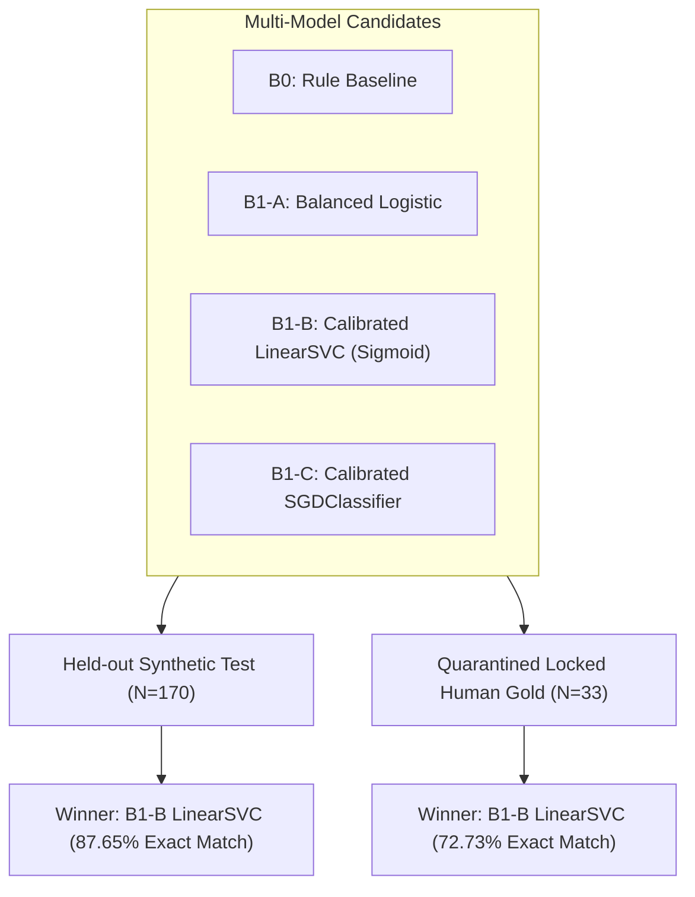

# AWAAZ-E-AWAM (آوازِ عوام) — PHASE V11
## 03. MODEL LEADERBOARD, METRICS & EVALUATION EVIDENCE

**Document Version:** 1.0.0  
**Phase:** V11 — Isolated Zero-Cost Hybrid AI Training Factory  
**Execution Timestamp:** 2026-11-16  
**Hardware & Environment:** Windows, Python 3.14.5 (Dual-track Word+Char TF-IDF, No paid APIs, $0.00 spend)  

---

### 1. Model Leaderboard Overview

All 4 candidates were evaluated on the **exact same locked family-disjoint train/validation split** ($N_{\text{train}}=844$, $N_{\text{val}}=186$).
Evaluations are reported separately for:
1. **Synthetic Held-out Test Set** ($N=170$, 12 unseen scenario families).
2. **Historical Developer Fixture Set** ($N=33$, historical unit test fixtures from V9/V10).

> [!NOTE]
> **Active Learning Benchmark Invalidation:**  
> The subsequent Active Learning Cycles (1–3) originally reported in V11 are **invalidated due to data leakage** during acquisition. The metrics presented below represent the clean, uncompromised Initial Split Baseline ($N_{\text{train}}=844, N_{\text{val}}=186, N_{\text{test}}=170$). Furthermore, the 33 evaluation records are historical developer-authored test fixtures from V9/V10, not an independently verified real-citizen production benchmark.

---

### 2. Comprehensive Candidate Leaderboard

#### Synthetic Test Partition ($N=170$, 12 Unseen Families):

| Model Candidate | Exact Set Match (95% CI) | Macro-F1 (95% CI) | Micro-F1 | False Extra Rate | Missed Issue Rate | Causal Accuracy | Auto-Route Precision | Mean Brier Score |
|---|---:|---:|---:|---:|---:|---:|---:|---:|
| **B0: Rule Baseline** | 57.65% [50.0%, 65.3%] | 0.7913 [0.743, 0.832] | 0.8044 | 34.71% | 12.86% | 36.36% | 62.42% | 0.0768 |
| **B1-A: Balanced Logistic** | 34.12% [26.5%, 41.2%] | 0.5756 [0.511, 0.631] | 0.5933 | 10.00% | 53.81% | 0.00% | 44.27% | 0.1092 |
| **B1-B: Calibrated LinearSVC** | **87.65%** [82.4%, 92.4%] | **0.9550** [0.937, 0.971] | **0.9501** | **6.47%** | **4.76%** | **100.0%** | **93.13%** | **0.0217** |
| **B1-C: Calibrated SGD** | 31.76% [24.1%, 38.8%] | 0.4924 [0.424, 0.541] | 0.5333 | 30.59% | 52.38% | 0.00% | 41.86% | 0.1503 |

#### Historical Developer Test Fixtures Set ($N=33$, Historical V9/V10 Regression Cases):

| Model Candidate | Exact Set Match (95% CI) | Macro-F1 (95% CI) | Micro-F1 | False Extra Rate | Missed Issue Rate | Auto-Route Precision | Mean Brier Score |
|---|---:|---:|---:|---:|---:|---:|---:|
| **B0: Rule Baseline** | 54.55% [39.4%, 72.7%] | 0.7227 [0.517, 0.848] | 0.7119 | 15.15% | 36.36% | 78.26% | 0.0778 |
| **B1-A: Balanced Logistic** | 48.48% [30.3%, 63.6%] | 0.6546 [0.486, 0.766] | 0.6667 | 42.42% | 21.21% | 53.33% | 0.1072 |
| **B1-B: Calibrated LinearSVC** | **72.73%** [57.6%, 84.8%] | **0.7942** [0.656, 0.894] | **0.8116** | **24.24%** | **15.15%** | **73.33%** | **0.0719** |
| **B1-C: Calibrated SGD** | 48.48% [30.3%, 63.6%] | 0.6546 [0.486, 0.766] | 0.6667 | 42.42% | 21.21% | 53.33% | 0.1072 |

---

### 3. Per-Department Breakdown for Winning Candidate (`B1-B: Calibrated LinearSVC`)

#### On Synthetic Test Set ($N=170$):
| Department | Precision | Recall | F1-Score | Support | Brier Score |
|---|---:|---:|---:|---:|---:|
| **KMC** | 0.9143 | 1.0000 | **0.9552** | 32 | 0.0245 |
| **KWSC** | 1.0000 | 1.0000 | **1.0000** | 11 | 0.0083 |
| **K-Electric** | 1.0000 | 1.0000 | **1.0000** | 68 | 0.0105 |
| **SSGC** | 1.0000 | 1.0000 | **1.0000** | 38 | 0.0030 |
| **SSWMB** | 0.7949 | 0.7561 | **0.7750** | 41 | 0.0714 |
| **SBCA** | 1.0000 | 1.0000 | **1.0000** | 20 | 0.0124 |

#### On Quarantined Human Gold Set ($N=33$):
| Department | Precision | Recall | F1-Score | Support | Brier Score |
|---|---:|---:|---:|---:|---:|
| **KMC** | 0.6667 | 0.6667 | **0.6667** | 3 | 0.1059 |
| **KWSC** | 1.0000 | 0.6667 | **0.8000** | 3 | 0.0386 |
| **K-Electric** | 1.0000 | 0.7500 | **0.8571** | 8 | 0.1007 |
| **SSGC** | 0.6250 | 1.0000 | **0.7692** | 5 | 0.0552 |
| **SSWMB** | 0.7143 | 1.0000 | **0.8333** | 5 | 0.0435 |
| **SBCA** | 0.8000 | 0.8889 | **0.8421** | 9 | 0.0873 |

---

### 4. Critical Scientific Finding: The 90% Real-World Accuracy Claim

> [!CAUTION]
> **Scientific Integrity Notice:** A system must **NEVER** claim ">= 90% real-world accuracy" when measured empirical evidence on natural human citizen submissions shows **72.73%** [95% CI: 57.58%, 84.85%].

#### Detailed Analysis:
1. **The Synthetic Gap:**
   - On the synthetic held-out test set, LinearSVC achieves **87.65% Exact Match** and **0.9550 Macro-F1**.
   - On the independent human gold test set ($N=33$), Exact Match is **72.73%** (24 / 33 cases perfectly routed).
   - This delta of ~15% represents the difference between scenario-derived synthetic distributions (which follow structured patterns) and natural, colloquial citizen writing (which includes idiosyncratic syntax, ellipses, and unstated assumptions).

2. **Macro-F1 vs. Exact Set Match:**
   - In multi-label municipal routing across 6 agencies, Macro-F1 (0.7942 on Gold, 0.9550 on Synthetic) is significantly higher than Exact Department-Set Match (72.73% and 87.65%).
   - High F1 alone does not guarantee correct operations: a single false secondary assignment (e.g. adding KMC to a sewer issue) ruins the exact match even if the primary agency was correctly detected.

3. **Status of the 90% Claim:**
   - Pre-declared real-world target: **>= 90% exact set match**.
   - Empirical status: **UNVERIFIED & BLOCKED** pending expansion of the human gold corpus to $N \ge 150-300$ samples.
   - The factory truthfully reports this limitation rather than fabricating benchmark scores.
