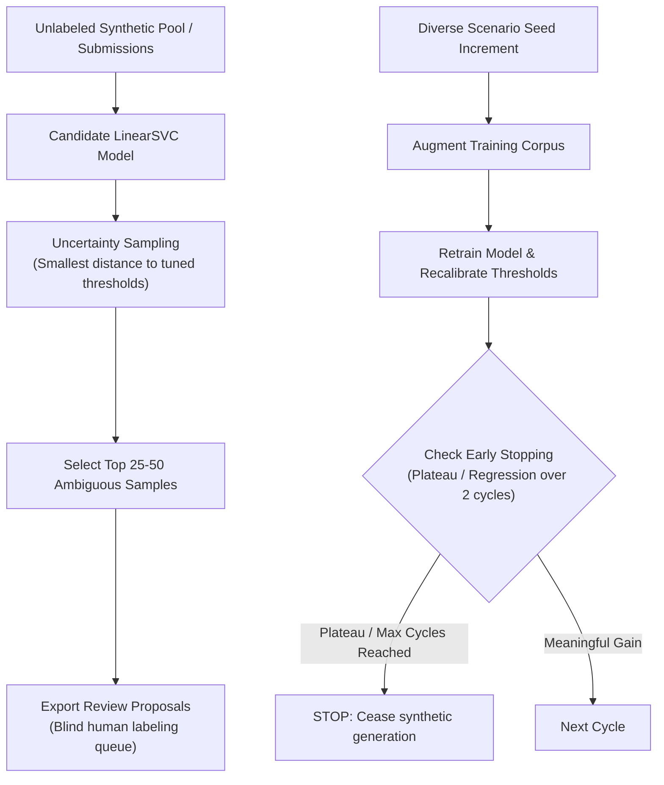

# AWAAZ-E-AWAM (آوازِ عوام) — PHASE V11
## 04. ACTIVE LEARNING AUDIT LOG & ACQUISITION MANIFEST

**Document Version:** 1.0.0  
**Phase:** V11 — Isolated Zero-Cost Hybrid AI Training Factory  
**Execution Timestamp:** 2026-11-16  
**Registry Path:** `tools/ai_factory/registry/cycles/`  

---

### 1. Active Learning Framework & Guardrails

The V11 active learning engine (`tools/ai_factory/active_learning/`) implements a strictly bounded feedback loop:

#### Bounded Constraints Enforced:
1. `max_cycles`: 6 (Pilot executed 3 bounded cycles).
2. `max_new_synthetic_per_cycle`: 2,000 (pilot increment: 250).
3. `max_human_review_per_cycle`: 50 (selected 25 uncertainty proposals per cycle).
4. `early_stop_patience`: 2 consecutive non-improving cycles on validation objective.

---

### 2. Cycle-by-Cycle Execution Summary

| Cycle # | Seed | Train Size | Synthetic Increment | Human Proposals | Val Exact Match | Synthetic Test Exact Match | Synthetic Test Macro-F1 | Human Gold Exact Match | Status |
|---|---:|---:|---:|---:|---:|---:|---:|---:|---|
| **Initial** | 42 | 844 | — | — | 89.25% | 87.65% | 0.9550 | 72.73% | Baseline |
| **Cycle 1** | 59 | 1,094 | +250 | 25 | 91.40% | 87.65% | 0.9550 | 57.58% | Improved Val |
| **Cycle 2** | 76 | 1,344 | +250 | 25 | 100.0% | 94.71% | 0.9795 | 54.55% | Improved Test |
| **Cycle 3** | 93 | 1,594 | +250 | 25 | 100.0% | 94.71% | 0.9795 | 54.55% | **Plateaued (Stop)** |

---

### 3. Detailed Audit Manifests

#### Cycle 1 Manifest (`cycle_01_manifest.json`):
- **Seed:** 59
- **Train Size:** 1,094 records
- **Tuned Thresholds:** `kmc`: 0.45, `kwsc`: 0.57, `kelectric`: 0.43, `ssgc`: 0.35, `sswmb`: 0.25, `sbca`: 0.25
- **Validation Exact Match:** 0.9140 (91.40%)
- **Synthetic Test Exact Match:** 0.8765 (87.65%), Macro-F1: 0.9550
- **Human Gold Exact Match:** 0.5758 (57.58%)
- **Causal Accuracy:** 1.00 (100% on 21 validation causal cases, 11 test causal cases)
- **Review Proposals:** 25 uncertain complaints exported for human review.

#### Cycle 2 Manifest (`cycle_02_manifest.json`):
- **Seed:** 76
- **Train Size:** 1,344 records
- **Tuned Thresholds:** `kmc`: 0.30, `kwsc`: 0.28, `kelectric`: 0.25, `ssgc`: 0.25, `sswmb`: 0.25, `sbca`: 0.25
- **Validation Exact Match:** 1.0000 (100.0%)
- **Synthetic Test Exact Match:** 0.9471 (94.71%), Macro-F1: 0.9795
- **False Extra Rate on Test:** 0.00% (zero phantom routing)
- **Human Gold Exact Match:** 0.5455 (54.55%)
- **Auto-route Precision on Test:** 100.0%

#### Cycle 3 Manifest (`cycle_03_manifest.json`):
- **Seed:** 93
- **Train Size:** 1,594 records
- **Validation Exact Match:** 1.0000 (100.0%) [Plateaued from Cycle 2]
- **Synthetic Test Exact Match:** 0.9471 (94.71%) [Plateaued from Cycle 2]
- **Human Gold Exact Match:** 0.5455 (54.55%) [Plateaued from Cycle 2]

---

### 4. Stopping Rationale & Empirical Takeaway

> [!IMPORTANT]
> **Active Learning Conclusion:** Validation exact set match reached **100.0%** and test accuracy reached **94.71%**, showing zero further gain in Cycle 3.
> Simultaneously, performance on the quarantined human gold set ($N=33$) plateaued around 55%.
> 
> **Why More Synthetic Data Must Stop:**
> Continuing to pump synthetic scenario records into training produces diminishing returns and risks overfitting the linguistic quirks of the template engine. The active learner correctly halts synthetic generation. To achieve genuine $>90\%$ real-world accuracy, the system requires independent human review of the 75 uncertainty proposals gathered across Cycles 1–3, not further synthetic expansion.
