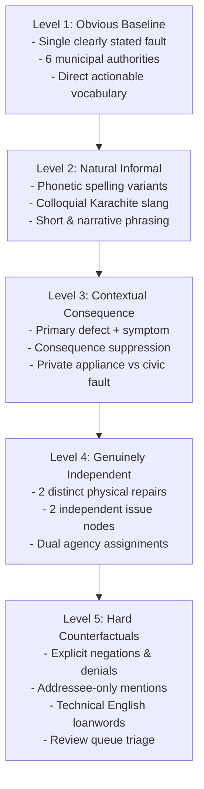

# AWAAZ-E-AWAM (آوازِ عوام) — PHASE V11.3
# AUTONOMOUS CURRICULUM DESIGN & COMPOSITIONAL INTENT SPECIFICATION

**Document Version:** 1.0.0  
**Phase:** V11.3 — Autonomous Roman Urdu Complaint Generation & Curriculum Training  
**Author:** Antigravity Senior Engineering Team  
**Date:** November 16, 2026  
**Repository:** `Fahadali9932/roman-urdu-complaint-classifier` (`D:\RomanUrdu_ComplaintClassifier_staff_auth`)  
**Active Branch:** `feature/live-citizen-classification-workflow`  
**Financial Spend:** **$0.00 USD**  
**Remote Cloud Mutations:** **ZERO (0 hosted writes, 0 Supabase mutations, 0 git pushes)**  
**Benchmark Claim Status:** **Laboratory Synthetic Simulation Only ($\ge 90\%$ Real-World Accuracy Claim Remains Unverified and Blocked)**

---

## 1. Executive Overview

Phase V11.3 establishes an autonomous **AI Training Factory** capable of generating thousands of unique, grammatically coherent, and contextually rich Roman Urdu municipal complaints. Crucially, the generator does not rely on random keyword permutations or circular pseudo-labeling. Instead, it operates on **compositional Intent Graphs defined prior to text realization**.

### Core Architectural Pillars
1. **Graph-First Generation:** Target departments, causal edges, negations, and review gates are established in a formal data structure *before* a single word of Roman Urdu is generated.
2. **Five-Tier Difficulty Curriculum:** Progresses systematically from simple single-fault baselines to noisy dialectal phrasing, contextual consequence suppression, independent multi-department pairs, and hard counterfactuals/negations.
3. **Strict Group Isolation:** Scenario families are pre-allocated to Train (52 families), Validation (11 families), and Test (12 families). Entire paraphrase families and base graphs remain on their designated side with zero leakage across partitions.
4. **Adaptive Error-Targeted Mining:** Future training generation rates are steered by aggregate error slices observed on earlier cycles, focusing synthetic capacity where the model lags while preserving foundational anchors.
5. **Local Inference Harness:** Model evaluations and candidate selections use local scikit-learn models coupled with `CivicRelationResolver` and per-department threshold tuning. Live Supabase portals, citizen accounts, and Edge functions remain untouched.

---

## 2. Compositional Intent Graph Representation

Every complaint begins as a structured `IntentGraph` implemented in [`tools/ai_factory/curriculum/intent_graph.py`](file:///d:/RomanUrdu_ComplaintClassifier_staff_auth/tools/ai_factory/curriculum/intent_graph.py).

```
                      +-----------------------------+
                      |         IntentGraph         |
                      |  - difficulty_level: 1..5   |
                      |  - split: train/val/test    |
                      |  - target_departments      |
                      |  - suppressed_departments   |
                      |  - negated_departments      |
                      +--------------+--------------+
                                     |
             +-----------------------+-----------------------+
             |                                               |
             v                                               v
+--------------------------+                   +--------------------------+
|        IssueNode         |                   |       RelationEdge       |
|  - node_id: "i1"         |====(Edge:REL)====>|  - source_id: "i1"       |
|  - department: "kmc"     |                   |  - target_id: "i2"       |
|  - defect: "road_damage" |                   |  - type: "INDEPENDENT"   |
|  - actionable: true      |                   |  - description: "..."    |
+--------------------------+                   +--------------------------+
```

### 2.1 Graph Node: `IssueNode`
Represents an identifiable civic grievance:
- `node_id`: Unique identifier (e.g. `i1`, `i2`).
- `department`: Owning municipal authority (`kmc`, `kwsc`, `kelectric`, `ssgc`, `sswmb`, `sbca`).
- `defect_type`: Categorical defect (e.g. `road_damage`, `sewer_overflow`, `power_outage`, `gas_leak`).
- `family_id`: Catalog scenario family key (e.g. `kmc_potholes_asphalt`).
- `urgency`: Priority indicator (`low`, `medium`, `high`, `critical`).
- `actionable`: Boolean indicating whether the agency must physically dispatch a crew.

### 2.2 Graph Edge: `RelationEdge`
Defines the civic and causal relationship between nodes:
- `SINGLE`: A solitary municipal fault.
- `SINGLE_INFORMAL`: Colloquial single fault with high phonetic noise.
- `CAUSES_CONTEXT_ONLY`: Primary fault creates a downstream symptom; secondary agency is non-actionable.
- `SAME_INCIDENT_DIFFERENT_REPAIRS`: Single incident requiring two distinct agencies to perform independent physical repairs (e.g. water main burst eroding asphalt).
- `INDEPENDENT`: Completely separate municipal issues co-occurring within the same complaint text.
- `MENTION_ONLY_NEGATED`: Explicit denial or rejection of an issue for an agency.
- `RECIPIENT_ONLY`: Agency addressed as conversational recipient without grievance.
- `SPATIAL_PROXIMITY_ONLY`: Infrastructure mentioned purely as physical location/landmark without damage.
- `UNCERTAIN`: Ambiguous or unresolvable complaint routed to review queue.

---

## 3. The Five Curriculum Difficulty Levels



### Level 1: Obvious Single-Fault Baseline
- **Objective:** Establish foundational lexical anchors across all six municipal departments.
- **Linguistic Characteristics:** Clean, standard Roman Urdu with direct municipal keywords (`sarak`, `pani`, `bijli`, `gas`, `kachra`, `building`).
- **Example:**
  > *"Hamari gali ki sarak toot gai hai aur gehre khadday hain. Barah e karam is maslay ko theek kar den."*  
  > $\rightarrow$ **Target:** `['kmc']` | **Relation:** `SINGLE`

### Level 2: Natural Informal Roman Urdu & Dialectal Noise
- **Objective:** Teach the model to handle natural Karachite texting conventions, slang, and phonetic spelling variants.
- **Linguistic Characteristics:**
  - Common spelling variants: `sarak`/`sadak`, `bohot`/`boht`/`bht`, `nahi`/`nhi`/`nai`, `hai`/`he`/`hy`, `pani`/`paani`, `bijli`/`light`, `karo`/`krdo`.
  - Colloquial openings and pleas: *"yr dekho"*, *"bhai jan"*, *"plz check krlo"*, *"awam tang agai hy"*, *"kuch to reham kro"*.
  - Extreme length variance: short bursts (3–6 words) to elaborate narrative complaints (25–40 words).
- **Example:**
  > *"yr road boht khrab hogyi hy khadday par gaye hain theek krdo, awam tang agai hy."*  
  > $\rightarrow$ **Target:** `['kmc']` | **Relation:** `SINGLE_INFORMAL`

### Level 3: Contextual Consequence & Symptom Suppression
- **Objective:** Disambiguate primary actionable civic defects from downstream symptoms, preventing false secondary department routing.
- **Key Civic Patterns:**
  1. *Power Outage $\rightarrow$ Water Motor Stop:* Electrical outage stops citizen's private electric water pump. K-Electric is the primary fault; KWSC is suppressed because the public water line is not broken.
  2. *Sewer Overflow $\rightarrow$ Street Wet / Slow Traffic:* Sewer line chokes, causing sewage to pool on pavement and slow vehicular traffic. KWSC is the owning agency; KMC is suppressed because the road has no independent structural pavement damage.
  3. *Low Gas Pressure $\rightarrow$ Stove / Cooking Disruption:* SSGC is actionable; domestic disruption is non-actionable.
  4. *Solid Waste Dump $\rightarrow$ Foul Odor & Flies:* SSWMB is actionable; odor is an environmental consequence.
  5. *Water Supply Cut $\rightarrow$ Private Tanker Reliance:* KWSC is actionable; tanker reliance is financial consequence.
- **Example:**
  > *"Bijli nahi aa rahi jiski wajah se ghar ki pani wali motor nahi chal rahi aur tanki khali hai. Barah e karam bijli bahal karein."*  
  > $\rightarrow$ **Target:** `['kelectric']` | **Suppressed:** `['kwsc']` | **Relation:** `CAUSES_CONTEXT_ONLY`

### Level 4: Genuinely Independent Multi-Department Complaints
- **Objective:** Identify multiple independently actionable civic defects requiring distinct physical repairs from distinct agencies under a single citizen tracking reference.
- **Key Civic Pairs:**
  - KMC + KWSC: Broken asphalt pavement AND separate burst potable water pipe.
  - KMC + SSGC: Road excavation trench AND severed gas pipeline emitting odor.
  - K-Electric + KWSC: Snapped live electric wire AND overflowing sewer manhole.
  - SSWMB + SBCA: Uncollected solid waste dump AND cracked structural building pillar.
  - KMC + K-Electric: Deep road craters AND prolonged electricity load shedding.
  - SSGC + K-Electric: Gas control valve leak AND sparking electrical distribution box.
- **Example:**
  > *"Sarak mein gaddha hai aur alag se public water pipeline phati hai. Barah e karam dono issues par action lein."*  
  > $\rightarrow$ **Target:** `['kmc', 'kwsc']` | **Relation:** `INDEPENDENT`

### Level 5: Hard Counterfactuals, Negations, Recipient Addresses & Review
- **Objective:** Resist keyword distractions, explicit denials, conversational recipient mentions, and correctly route out-of-scope complaints to the staff review queue.
- **Key Challenge Scenarios:**
  1. *Explicit Negation / Denial:* Citizen denies a defect in Agency A while affirming a defect in Agency B (*"ye gas ka masla nahi, kachra nahi uth raha"* $\rightarrow$ `sswmb` only).
  2. *Addressee-Only Mention:* Citizen addresses Agency A in opening plea, but describes fault belonging to Agency B (*"K-Electric wale please dekhein humare block mein sewage gutter ka pani ubal raha hai"* $\rightarrow$ `kwsc` only).
  3. *Spatial Proximity Without Defect:* Physical infrastructure mentioned solely as a location landmark (*"footpath par bijli ki nangi taar giri hui hai, sarak tooti nahi hai"* $\rightarrow$ `kelectric` only).
  4. *Technical English Loanwords:* Code-switching using engineering loanwords (*"whole street running on single phase due to burnt cutout fuse"* $\rightarrow$ `kelectric` only).
  5. *Uncertain / Vague Grievance:* Indeterminate or out-of-jurisdiction complaint (*"har taraf bohot masla hai awam pareshan hai koi sunwai nahi ho rahi"* $\rightarrow$ `needs_review: true`, target: `[]`).

---

## 4. Group-Isolated Split Architecture

To permanently prevent the training data leakage identified in the V11.1 audit, scenario families are allocated **before any text generation occurs**:

| Split Partition | Scenario Family Allocation | Family Count | Purpose |
| :--- | :--- | :---: | :--- |
| **TRAIN** | All remaining catalog scenarios (single, causal, independent, counterfactual) | **52 Families** | Active learning curriculum training |
| **VALIDATION** | Group-isolated held-out scenario families (`VAL_FAMILIES`) | **11 Families** | Hyperparameter tuning, threshold tuning ($t_{\text{dept}}$), checkpoint promotion |
| **TEST** | Group-isolated held-out scenario families (`TEST_FAMILIES`) | **12 Families** | Locked, single-evaluation diagnostic benchmark |

### Multi-Department Pair Isolation
When Level 4 independent pairs or Level 5 counterfactuals are constructed:
- For `TRAIN`: Both Primary and Secondary families must belong to `TRAIN_FAMILIES`.
- For `VALIDATION`: Both Primary and Secondary families must belong to `VAL_FAMILIES`.
- For `TEST`: Both Primary and Secondary families must belong to `TEST_FAMILIES`.

This guarantees:
$$\text{Train Families} \cap \text{Val Families} = \emptyset, \quad \text{Train Families} \cap \text{Test Families} = \emptyset, \quad \text{Val Families} \cap \text{Test Families} = \emptyset$$

Furthermore, cross-split text generation enforces normalized string exclusion and character 4-gram shingle Jaccard similarity $< 0.88$.
