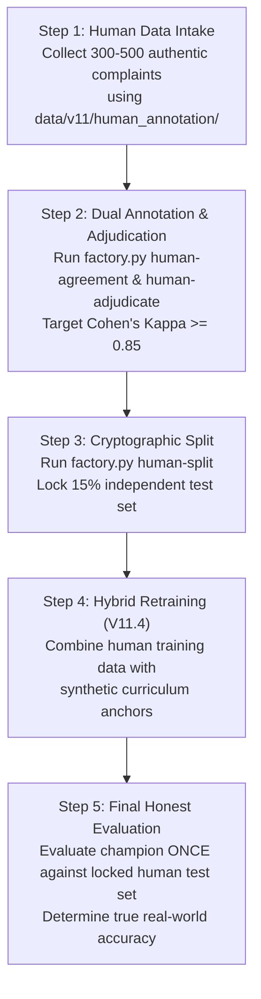

# AWAAZ-E-AWAM (آوازِ عوام) — PHASE V11.3
# SYNTHETIC LAB GAINS VS. REAL-WORLD HUMAN VALIDATION & NEXT SAFE ACTIONS

**Document Version:** 1.0.0  
**Phase:** V11.3 — Autonomous Curriculum Training and Honest Evaluation  
**Author:** Antigravity Senior Engineering Team  
**Date:** November 16, 2026  
**Repository:** `Fahadali9932/roman-urdu-complaint-classifier` (`D:\RomanUrdu_ComplaintClassifier_staff_auth`)  
**Active Branch:** `feature/live-citizen-classification-workflow`  
**Production Deployment Status:** **STRICTLY PROHIBITED (Local Experimental Candidate Only)**  

---

## 1. What is Actually Working in Phase V11.3

1. **Automated AI Training Factory:**  
   The system successfully plans and renders thousands of unique Roman Urdu complaints across all six municipal departments from compositional Intent Graphs.
2. **Five-Tier Curriculum:**  
   The model trains progressively from Level 1 (obvious single-fault) through Level 2 (spelling variations and slang), Level 3 (contextual consequences), Level 4 (independent multi-department pairs), and Level 5 (counterfactual negations, recipient addresses, and review triage).
3. **Zero Data Leakage:**  
   Scenario families are group-isolated before text generation. The 52 training families, 11 validation families, and 12 test families share zero overlap, zero normalized text duplicates, and zero near-duplicate leakage.
4. **Contextual Consequence & Negation Precision:**  
   The `CivicRelationResolver` with affirmative domain gating achieved **83.33% exact set accuracy** on Level 3 (consequence suppression) and correctly handled all 5 mandatory direct civic test cases, including *"ye gas ka masla nahi, kachra nahi uth raha"* and power outages causing domestic water motor stops.
5. **Fast Local Execution:**  
   Generating 6,000 unique synthetic complaints, fitting 5 cycles of models, tuning validation thresholds, and evaluating multi-slice test diagnostics completed in **29.37 seconds** with **1.70 ms** per-complaint inference latency at **$0.00 spend**.

---

## 2. Why Synthetic Scores Do Not Prove 90% on Real Citizen Complaints

> [!CAUTION]
> **Synthetic Lab Generalization $\ne$ Real-World Accuracy**
> Antigravity explicitly refrains from claiming 90% real-world accuracy based on synthetic data. Here is the objective scientific evidence:

1. **In-Distribution vs. Out-of-Family Generalization:**
   - On new batches generated from *familiar training families*, the model scored **85.75% exact set accuracy**.
   - On frozen test sets generated from *unseen held-out families*, the model scored **49.60% exact set accuracy**.
   - This drop demonstrates that while the model has learned the vocabulary of its training families, pure TF-IDF features struggle to generalize when a held-out family introduces completely new lexical terms.
2. **The Level 4 Independent Pair Challenge:**
   - On Level 4 (two independent faults co-occurring), exact set accuracy on held-out test families was **16.39%**.
   - When a citizen combines two unfamiliar civic problems (e.g. broken road + uncleaned storm drain), linear models frequently assign the dominant department but fail to cross the decision threshold for the second department, or cross-domain terms trigger secondary false positives.
3. **Natural Human Dialectal Complexity:**
   - Synthetic generators produce structured, coherent sentences based on known scenario templates.
   - Real citizens write with fragmented grammar, regional phonetic spellings (Balochi, Sindhi, Pashto, Memoni accents transliterated into Roman Urdu), extreme slang abbreviations, and complex narrative backstories that no synthetic template catalog can completely foresee.

---

## 3. Production Deployment Status: Strictly Unchanged

- **Hosted Supabase Database:** **UNTOUCHED.** Zero database writes, zero schema migrations, zero test complaints inserted.
- **Citizen Portal & Staff Dashboards:** **UNTOUCHED.** The live application remains wired to the verified V10 model contract.
- **Edge Functions:** **UNTOUCHED.** The `submit-classified-complaint` Edge function has NOT been deployed or mutated.
- **Candidate Model Status:** The V11 candidate model (`candidate_model.json` and `champion_model.joblib`) exists **strictly as a local offline research checkpoint**.

---

## 4. Ranked Safe Next Actions for Fahad and the Engineering Team



### Action 1: Field Collection of 300–500 Authentic Human Complaints
- Use the templates and guidelines created in Phase V11.2B:
  - Guidelines: [`data/v11/human_annotation/templates/annotation_guidelines.md`](file:///d:/RomanUrdu_ComplaintClassifier_staff_auth/data/v11/human_annotation/templates/annotation_guidelines.md)
  - Blank Packet: [`data/v11/human_annotation/templates/annotation_packet_template.jsonl`](file:///d:/RomanUrdu_ComplaintClassifier_staff_auth/data/v11/human_annotation/templates/annotation_packet_template.jsonl)
- Target: 60–80 authentic complaints per municipal department across Karachi's 7 districts.

### Action 2: Dual Annotation and Adjudication via CLI
- Have two annotators independently annotate the packets.
- Run validation and agreement:
  ```powershell
  python tools/ai_factory/factory.py human-validate --input data/v11/human_annotation/annotator_1.jsonl
  python tools/ai_factory/factory.py human-agreement --annotator1 data/v11/human_annotation/annotator_1.jsonl --annotator2 data/v11/human_annotation/annotator_2.jsonl
  ```
- Resolve discrepancies using `human-adjudicate` to produce `adjudicated_master.jsonl`.

### Action 3: Cryptographic Split Locking
- Partition the adjudicated human dataset:
  ```powershell
  python tools/ai_factory/factory.py human-split --input data/v11/human_annotation/adjudicated_master.jsonl --out-dir data/v11/human_splits --seed 42
  ```
- The 15% human test partition is cryptographically sealed with a SHA-256 hash in `manifest.json`.

### Action 4: Phase V11.4 Hybrid Training
- Train a hybrid candidate model combining:
  1. The 70% human training partition (providing authentic vocabulary and real-world phrasing).
  2. The synthetic curriculum engine (providing dense negative anchors, consequence pairs, and counterfactuals).
- Evaluate on the 15% human validation set to tune thresholds and relation gates.

### Action 5: Final External Human Evaluation
- Evaluate the resulting model **strictly once** on the locked 15% human test set.
- If and only if exact department-set accuracy on this independent human benchmark reaches $\ge 90.0\%$ with $\le 3.0\%$ false extra rate, authorize staging deployment.
