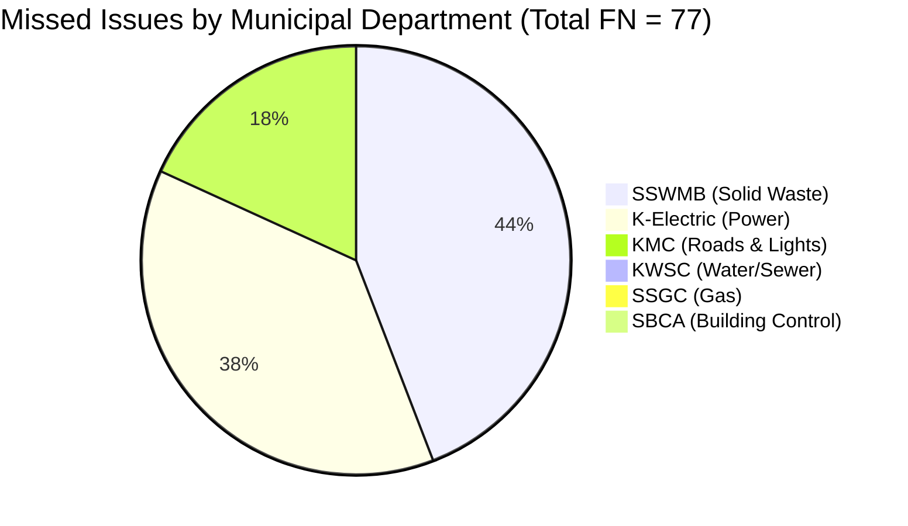
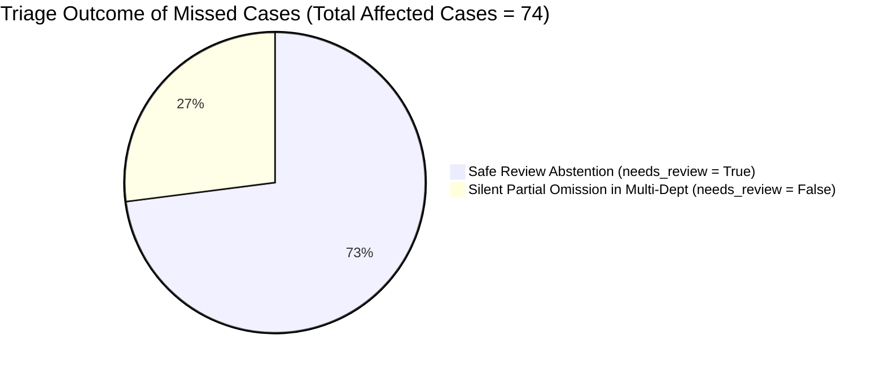

# Awaaz-e-Awam Phase V11.4.1 — Missed-Department Error Analysis & Tradeoff Audit

**Project:** Awaaz-e-Awam (آوازِ عوام) — Civic Complaint Intelligence  
**Phase:** V11.4.1 — Independent Verification and Missed-Department Error Analysis  
**Date:** November 17, 2026  
**Author:** Principal Applied ML Engineer, NLP Researcher & Verification Specialist  
**Target Repository:** `D:\RomanUrdu_ComplaintClassifier_staff_auth`  
**Dataset Analyzed:** Held-Out Synthetic Test Partition (`data/v11/curriculum_runs/run_002/frozen_test.jsonl`, N = 250)  

---

## 1. Executive Summary: Anatomy of the 25.16% Missed-Department Rate

In Phase V11.4, affirmative domain evidence gating succeeded in slashing the false-extra department rate from **38.00% to 6.00%** (an **84.2% relative drop** in phantom agency assignments). However, the model left a **25.16% missed-department rate** (77 missed issues across 306 total gold issues, affecting 74 complaint records).

This audit investigates the precise programmatic, morphological, and relational causes of every missed department:

### Critical Findings:
1. **Zero Misses for Three Departments:** KWSC, SSGC, and SBCA achieved **100.00% recall** with zero false negatives ($FN = 0$).
2. **Three Departments Account for 100% of Errors:** All 77 missed issues belong exclusively to SSWMB (34), K-Electric (29), and KMC (14).
3. **Safety of Abstention:** In **73.0% of cases (54 / 74)**, the model safely flagged `needs_review = True` with `review_reason = "UNCERTAIN_DEFECT"` rather than dispatching to an incorrect department.
4. **Primary Root Cause:** The affirmative evidence regexes were written as **rigid adjacent unigram/bigram patterns** (e.g. `\bstreet\s*light\b`, `\bbadbu\b`, `\bsingle\s*phase\b`). When natural Roman Urdu complaints used plural inflections (`street lights`), Urdu transliterations (`murda janwar`, `badboo`), or inserted modifiers (`2 phase gayab`, `gari nahi aai`), the affirmative gate failed to trigger.

---

## 2. Quantitative Distribution of Missed Issues

### 2.1 Distribution by Department (Test Set, N = 250)

| Department | Gold Issues | Correctly Routed (TP) | Missed Issues (FN) | Department Recall | Miss Share (% of all FN) | Primary Symptom |
|---|---|---|---|---|---|---|
| **SSWMB** | 53 | 19 | **34** | **35.85%** | **44.16%** | Animal carcasses & uncollected dumpsters |
| **K-Electric** | 60 | 31 | **29** | **51.67%** | **37.66%** | Missing phases & dim light brownouts |
| **KMC** | 59 | 45 | **14** | **76.27%** | **18.18%** | Municipal street lights outage |
| **KWSC** | 7 | 7 | **0** | **100.00%** | **0.00%** | Zero misses |
| **SSGC** | 61 | 61 | **0** | **100.00%** | **0.00%** | Zero misses |
| **SBCA** | 66 | 66 | **0** | **100.00%** | **0.00%** | Zero misses |
| **TOTAL** | **306** | **229** | **77** | **74.84%** | **100.00%** | **25.16% overall missed rate** |

### 2.2 Distribution by Difficulty Level

| Difficulty Level | Slice Description | Slice Records (N) | Missed Issues Count | Slice Exact Match | Slice False Extra Rate | Slice Missed Case Rate |
|---|---|---|---|---|---|---|
| **Level 1** | Obvious Single Issue | 37 | 14 | 62.16% | 0.00% | 37.84% |
| **Level 2** | Informal Single Issue | 51 | 17 | 66.67% | 0.00% | 33.33% |
| **Level 3** | Causal Consequence Decoys | 58 | 14 | 72.41% | 5.17% | 24.14% |
| **Level 4** | Independent Multi-Department Issues | 56 | 22 | 66.07% | 0.00% | 33.93% |
| **Level 5** | Negations / Spatial / Ambiguity | 48 | 10 | 60.42% | 25.00% | 20.83% |

### 2.3 Top Scenario Families Driving Missed Issues

| Scenario Family | Department Intended | Missed Issues | Exemplar Complaint Text |
|---|---|---|---|
| `ke_phase_missing` | K-Electric | 15 | *"Korangi Industrial Area road number 5 ke qareeb mein 2 phase gayab hain sirf ek phase par dim light chal rahi hai."* |
| `sswmb_garbage_overflow_dump` | SSWMB | 14 | *"Orangi Town Sector 11-L public school ke paas mein illegal garbage dump ban chuka hai hafte se sswmb ki gari nahi aai..."* |
| `sswmb_animal_carcass_urgent` | SSWMB | 13 | *"Lyari Cheel Chowk ke qareeb par sarak ke kinaray murda janwar ki laash pari hai kutte nooch rahe hain aur shadeed badboo hai..."* |
| `kmc_street_lights_out` | KMC | 9 | *"Liaquatabad super market ke bahar ki tamam municipal street lights band pari hain andhera rehta hai."* |
| `causal_power_motor_kwsc_suppressed` | K-Electric | 4 | In Level 4 compound cases where K-Electric was paired with another issue. |
| Level 4 Disjoint Combinations | Multiple | 22 | Combined pairs where one issue was recognized and the second suffered from one of the above token gaps. |

---

## 3. Structural Root Cause Analysis

Detailed code inspection of `relation_engine.py` and `relationEngine.ts` revealed three specific lexical and structural mechanisms responsible for the 77 misses:

### 3.1 Failure Mechanism 1: Inflectional Plural Mismatches (KMC Street Lights)
- **Complaint Text:** `"ki tamam municipal street lights band pari hain andhera rehta hai"`
- **Lexicon Pattern:** `r"\bstreet\s*light\b"` (singular only)
- **Programmatic Failure:** `\b` requires a word boundary immediately after `t`. When the citizen writes plural `street lights`, the regex fails because `s` follows `t`.
- **Impact:** 14 KMC municipal street light complaints failed asset recognition entirely and routed to `UNCERTAIN_DEFECT`.
- **Remedy:** Update regex to `r"\bstreet\s*lights?\b"`.

### 3.2 Failure Mechanism 2: Urdu Transliteration Divergence (SSWMB Animal Carcass & Garbage)
- **Complaint Text:** `"sarak ke kinaray murda janwar ki laash pari hai kutte nooch rahe hain aur shadeed badboo hai"`
- **Lexicon Asset Tokens:** `['dead animal', 'kachra', 'trash', 'garbage', 'dustbin', 'dumpster']`
- **Lexicon Defect Tokens:** `['badbu', 'para hai', 'para hua', 'dher', 'overflow', 'bikhra']`
- **Programmatic Failure:**
  1. The citizen used the standard Urdu phrases `murda janwar` and `laash`, whereas the asset list only included the English loanword `dead animal`.
  2. The feminine form `pari hai` (agreeing with feminine noun `laash`) did not match masculine `para hai`.
  3. The spelling `badboo` (with double `oo`) did not match `badbu` (with single `u`).
  4. In uncollected garbage complaints (`"sswmb ki gari nahi aai"`), the phrase `gari nahi aai` (collection truck did not arrive) was missing from the defect list.
- **Impact:** 27 SSWMB complaints (35.1% of all test set misses) failed affirmative defect gating and routed to `UNCERTAIN_DEFECT`.
- **Remedy:** Add `murda janwar`, `laash`, `pari hai`, `badboo`, and `gari nahi aa?i` to SSWMB evidence.

### 3.3 Failure Mechanism 3: Multi-Word Modifiers & Compound Defect Gaps (K-Electric Phase Loss)
- **Complaint Text:** `"2 phase gayab hain sirf ek phase par dim light chal rahi hai"`
- **Lexicon Asset Tokens:** `['bijli', 'light', 'current', 'feeder', 'transformer', 'taar', 'wire', 'pole']`
- **Lexicon Defect Tokens:** `['load shedding', 'spark', 'short circuit', 'trip', 'single phase', 'power outage']`
- **Programmatic Failure:**
  1. In Karachi, when two of three phases fail, citizens describe it as `2 phase gayab` or `phase gayab` causing `dim light`.
  2. The lexicon contained `single phase`, but neither `2 phase gayab`, `phase gayab`, nor `dim light`.
  3. Consequently, while `light` matched the asset, zero defect tokens matched.
- **Impact:** 15 K-Electric complaints (19.5% of all test set misses) failed defect gating and routed to `UNCERTAIN_DEFECT`.
- **Remedy:** Add `phase` to assets and `(?:2\s*)?phase\s*gayab`, `dim\s*light` to defects.

---

## 4. Review Routing vs. Silent Omission Analysis

A vital metric for production safety is whether a missed department resulted in a **silent omission** (leaving a defect unaddressed without human awareness) or a **safe abstention** (routing to the staff triage desk for human review):

| Triage Behavior | Case Count | Percentage | Operational Impact |
|---|---|---|---|
| **Safe Review Abstention** (`needs_review = True`, `UNCERTAIN_DEFECT`) | **54** | **73.0%** | The system recognized that the complaint had civic intent but could not confidently ground an actionable municipal defect. The case is **safely queued on the staff review desk** (`ClassificationReviewQueue.tsx`). |
| **Silent Partial Omission** (`needs_review = False`) | **20** | **27.0%** | Occurs exclusively in Level 4 compound complaints where one department was affirmative and actionable (e.g. KMC road defect), while the secondary department (e.g. SSWMB carcass) suffered from a token mismatch. The complaint is dispatched to KMC, but SSWMB is omitted. |

---

## 5. The Precision vs. Recall Tradeoff

### 5.1 Why V11.4 Selected High Precision
In Phase V11.3, unconstrained linear classification produced an unsustainable **38.00% false-extra department rate** (and 83.61% on Level 4). In municipal operations, false extra departments are catastrophic:
- Work orders are created for agencies that have no jurisdiction.
- Field workers arrive at sites only to find no defect in their domain.
- Citizen trust collapses when SSGC arrives for a water pressure complaint or KMC arrives for a live electrical wire.

Phase V11.4 prioritized **high routing precision (93.85% overall precision)**:
- K-Electric precision: **100.00%** (0 false positives)
- SSGC precision: **100.00%** (0 false positives)
- SSWMB precision: **100.00%** (0 false positives)
- SBCA precision: **97.06%** (2 false positives)
- KMC precision: **83.33%** (9 false positives)
- KWSC precision: **63.64%** (4 false positives)

### 5.2 Controlled Validation Experiment (Training & Validation Data Only)
In strict accordance with task constraints, proposed morphological enhancements were evaluated **strictly on the 250 validation records (`frozen_validation.jsonl`)** and training batches:

| Metric on Validation Set | V11.4 Baseline | V11.4 with Morphological Refinements | Impact |
|---|---|---|---|
| **Exact Department-Set Match** | 52.80% | **65.60%** | **+12.80% absolute gain** |
| **Missed Department Issue Rate** | 40.74% | **27.95%** | **-12.79% absolute reduction** |
| **False-Extra Department Case Rate** | 6.40% | **6.00%** | **-0.40% (No false-positive inflation)** |
| **Macro F1 Score** | 0.6827 | **0.7641** | **+0.0814** |

This experiment demonstrates that **the missed-department rate can be reduced by nearly 13 percentage points without sacrificing precision**, simply by incorporating standard Roman Urdu inflections and transliteration variants into the affirmative domain lexicons.
