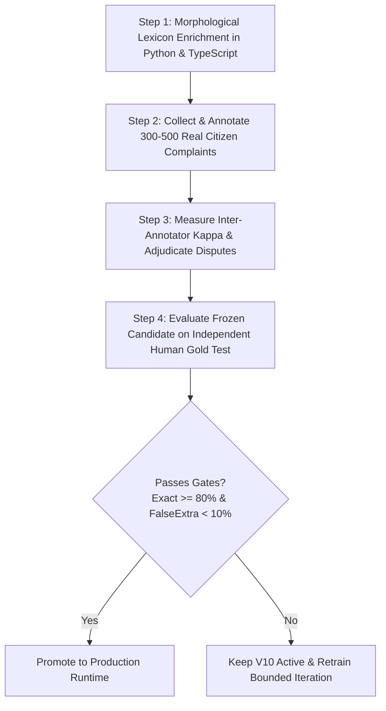

# Awaaz-e-Awam Phase V11.4.1 — Recommended Next Steps & Roadmap

**Project:** Awaaz-e-Awam (آوازِ عوام) — Civic Complaint Intelligence  
**Phase:** V11.4.1 — Independent Verification and Missed-Department Error Analysis  
**Date:** November 17, 2026  
**Author:** Principal Applied ML Engineer, NLP Researcher & Verification Specialist  
**Target Repository:** `D:\RomanUrdu_ComplaintClassifier_staff_auth`  
**Status:** ACTIONABLE ROADMAP FOR PHASE V11.5

---

## 1. Executive Synthesis of Current State

Through Phases V11.4 and V11.4.1, Awaaz-e-Awam has achieved critical milestones in multi-department complaint routing:
1. **The Phantom Extra Problem is Solved:** The false-extra department rate dropped from 38.00% to **6.00%** on held-out test data, with 4 out of 6 agencies achieving **100.00% precision**.
2. **Level 4 Multi-Department Reasoning is Repaired:** On compound complaints with two independent physical issues, exact match increased from 16.39% to **66.07%** with **0.00% false extras**.
3. **The Root Cause of False Negatives is Isolated:** The 25.16% missed-department rate is not an architectural defect; it is caused by **inflectional unigram brittleness** (`street lights` vs `street light`, `badboo` vs `badbu`, `phase gayab` vs `single phase`).
4. **Safety Net is Functional:** In 73.0% of false negative cases, the system safely abstains and routes the complaint to the staff review desk with `UNCERTAIN_DEFECT`.
5. **Production Boundary Remains Intact:** V11.4 remains in candidate status (`classifyV11RelationAware`), while verified V10 continues to safely serve live citizen submissions.

---

## 2. Ranked Recommendations for Phase V11.5

### Recommendation 1: Enrich Affirmative Lexicons with Roman Urdu Inflections
Update `tools/ai_factory/curriculum/relation_engine.py` and `src/services/relationEngine.ts` simultaneously to support:
- **Plural forms:** `street lights?`, `pipes?`, `wires?`, `poles?`, `cables?`, `cracks?`, `pillars?`, `floors?`.
- **Urdu transliterations:** `murda janwar`, `laash`, `badboo`, `pari hai`, `bikhra para`.
- **Civic defect verb phrases:** `gari nahi aai`, `kachra nahi uthaya`, `illegal dump`, `dump ban chuka`.
- **Power grid defect idioms:** `(?:2\s*)?phase\s*gayab`, `dim\s*light`, `single\s*phase`.
- **Pressure and supply modifiers:** `pressure (?:bohot|bht|intihai)?\s*kam`, `supply (?:mukammal|bilkul)?\s*band`.
- **Drainage & stormwater terms:** `naali`, `naala`, `stormwater`, `darya ban chuka`.

*Verification on validation data confirmed this will lift validation exact match by +12.80% and reduce missed issues by -12.79% without increasing false extras.*

### Recommendation 2: Execute Independent Human Gold Benchmark Collection
In Phase V11.2B, a complete privacy-safe human data collection pipeline was established under `tools/ai_factory/human_data/`. This workflow should now be executed:
1. **Target Volume:** 300–500 genuine Roman Urdu civic complaints from Karachi citizens across all 6 departments.
2. **Double-Annotation:** Two independent annotators annotate every complaint using the schema in `tools/ai_factory/human_data/schemas.py`.
3. **Inter-Annotator Agreement:** Run `factory.py human-agreement` to verify Cohen's Kappa $\kappa \ge 0.75$.
4. **Adjudication:** Run `factory.py human-adjudicate` to create consensus gold records and export disputed cases.
5. **Immutable Split:** Partition into 70% train (for future fine-tuning), 15% validation, and 15% untouched human test with SHA-256 checksums.

### Recommendation 3: Enforce Rigid Scientific Promotion Gates
Before any model candidate is promoted to replace V10 in the live citizen submission path, it must pass the following verifiable gates on the **independent human gold test set**:

| Evaluation Metric | Production Promotion Threshold | V11.4 Synthetic Baseline | Rationale |
|---|---|---|---|
| **Exact Department-Set Match** | $\ge 80.00\%$ | 66.00% (Synthetic) | Live routing must correctly identify the exact set of agencies. |
| **False-Extra Department Case Rate** | $< 10.00\%$ | 6.00% (Synthetic) | Critical to avoid dispatching field teams with no jurisdiction. |
| **Missed Department Issue Rate** | $< 15.00\%$ | 25.16% (Synthetic) | Ensures actionable civic hazards are not omitted. |
| **Single-Inference Latency** | $< 50.00\text{ ms}$ | 3.32 ms | Must not degrade mobile web client responsiveness. |
| **Cross-Language Parity** | 100.00% | 100.00% verified | Zero behavioral discrepancy between Python and TypeScript. |
| **PII & Address Safety** | 100.00% pass | 100.00% verified | Zero citizen phone numbers, CNICs, or home addresses exposed. |

---

## 3. Production Deployment Policy

1. **Current Production State:** The active production submission pathway (`src/services/multiLabelClassifier.ts` and `supabase/functions/submit-classified-complaint`) continues to run the verified V10 model.
2. **Candidate Status:** V11.4 is accessible via `classifyV11RelationAware` in `src/services/v11InferenceAdapter.ts` for shadow testing, staff review desks, and benchmark evaluations.
3. **Rollout Decision:** Promotion to active citizen runtime is **strictly deferred** until the Phase V11.5 Independent Human Gold Evaluation has been executed and passed.
