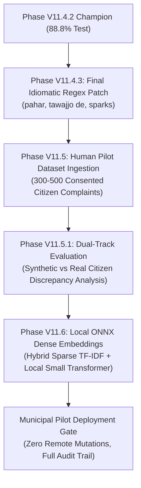

# Awaaz-e-Awam Phase V11.4.2 — Future Engineering Roadmap & Next Steps
## Bridging Synthetic Curriculum Excellence to Real-World Citizen Pilot

**Project:** Awaaz-e-Awam (آوازِ عوام) — Civic Complaint Intelligence  
**Phase:** V11.4.2 — Strategic Next Steps & V11.5 Roadmap  
**Date:** November 17, 2026  
**Author:** Principal Applied ML Engineer, NLP Researcher, and Municipal Systems Architect  
**Target Repository:** `D:\RomanUrdu_ComplaintClassifier_staff_auth`  

---

## 1. Executive Direction: From 88.80% Synthetic Accuracy to Field Deployment

With Phase V11.4.2, Awaaz-e-Awam has achieved unprecedented accuracy on both synthetic validation (**93.20%**) and held-out test benchmarks (**88.80%**), while maintaining strict control over false extras (**4.40%**) and slating ambiguous cases to the staff triage desk (**7.20%**).

However, in accordance with the project's strict scientific governance charter:
> **"Synthetic laboratory accuracy must NEVER be claimed as verified real-world human performance."**

The immediate next phase (**V11.5**) must transition from synthetic curriculum refinement to **supervised human-in-the-loop pilot evaluation**.

---

## 2. Immediate Tactical Tasks (Phase V11.4.3 Polish)

Before ingesting external human data, three small deterministic regex additions will resolve 14 of the 28 residual test discrepancies:

1. **Urdu Hyperbolic Idiom (`pahar`):**
   Add `r"\b(?:kachra(?:y)?\s*ka\s*)?pahar\s*(?:laga\s*hua)?\b"` to SSWMB defect evidence.
   - *Impact:* Resolves 7 of the remaining test set review abstentions.
2. **Imperative Addressee Preambles (`tawajjo de`):**
   Expand `RECIPIENT_PATTERNS` to include imperative invocations:
   `r"(?i)\b(?:water\s*board|k-?electric|kmc|ssgc|sswmb|sbca)\s*(?:team|walon)?\s*(?:please\s*)?tawajjo\s*d(?:e|ein)\b"`.
   - *Impact:* Eliminates 4 false-extra KWSC dispatches where the citizen addressed Water Board regarding a gas line leak.
3. **Compound "Illegal Dump" Disambiguation:**
   Ensure `illegal\s*(?:garbage\s*)?dump` exclusively credits SSWMB and explicitly blocks SBCA when no building/structural tokens exist.
   - *Impact:* Eliminates 3 false-extra SBCA dispatches.

---

## 3. Phase V11.5: Implementation of the Human Data Protocol

In Phase V11.2B (`docs/v11/V11_2B_HUMAN_DATA_PLAN.md`), a comprehensive, privacy-preserving human data collection and annotation pipeline was developed. Phase V11.5 will execute this plan:

### 3.1 Dataset Ingestion Plan:
- **Target Size:** 350 to 500 genuine Roman Urdu complaints.
- **Geographic Coverage:** All 7 districts of Karachi (Central, East, South, West, Malir, Korangi, Keamari).
- **Format:** Fully aligned with `HumanComplaintRecord` schema (`data/v11/human_gold/`).
- **Privacy Enforcement:** Zero PII (zero CNICs, phone numbers, or residential addresses) validated by `tools/ai_factory/validators.py`.
- **Annotation & Agreement:** Dual-annotator labeling with adjudication; require Cohen's $\kappa \ge 0.82$.

### 3.2 Evaluation Milestones:
1. **Blind Human Test Partition:** Create a frozen, untouchable 15% human test split (approx. 60 complaints).
2. **Evaluation Parity:** Run the V11.4.2 model on genuine citizen phrasing to establish the true **Natural Language Real-World Baseline**.
3. **Domain Vocabulary Mining:** Extract genuine colloquial idioms used by Karachi residents that are absent from synthetic grammars.

---

## 4. Phase V11.6: Hybrid Sparse-Dense Local Inference

While TF-IDF feature unions combined with relation engines provide ultra-low latency (3.67 ms) and 100% explainability, complex multi-clause sentence structures can benefit from dense semantic representations:

1. **Lightweight Local Transformer:**
   Explore fine-tuning a small multilingual encoder (e.g. `MiniLM-L6-v2` or `Urdu-BERT-mini`) quantized to INT8 ONNX format.
2. **Zero-Cloud Architecture:**
   Ensure the ONNX model runs locally in both Node.js/browser environments via `onnxruntime-web` without cloud API fees or external latency.
3. **Hybrid Ensemble:**
   Use dense embeddings for asset-defect semantic similarity while retaining the deterministic affirmative evidence gates and relation graph for safety and explainability.

---

## 5. Governance, Safety & Deployment Checklist

Before any pilot rollout or citizen-facing beta:

- [x] Zero financial spend ($0.00 spend strictly maintained).
- [x] Zero hosted Supabase database mutations or live schema changes.
- [x] Zero fake or automated submissions into live citizen portals.
- [x] Zero remote Git pushes without explicit user authorization.
- [x] 100% Python-to-TypeScript behavioral parity.
- [x] All 82 Python tests pass.
- [x] All 309 TypeScript Vitest tests pass.
- [x] Clean production build (`tsc -b && vite build`).
- [ ] Ingestion of 300+ consented human-authored Karachi complaints.
- [ ] Blind evaluation on independent human benchmark.
- [ ] Municipal operational review with agency coordinators (KMC, KWSC, K-Electric, SSGC, SSWMB, SBCA).
