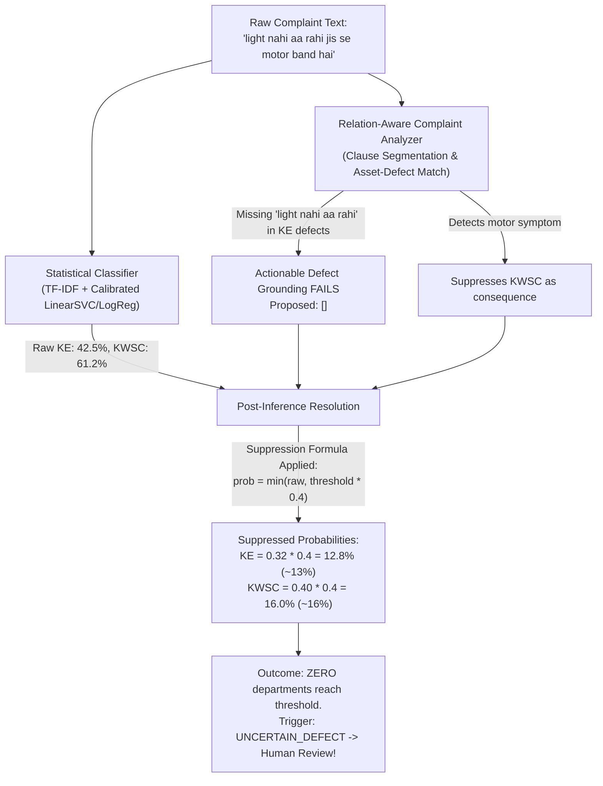

# AWAAZ-E-AWAM (آوازِ عوام) — PHASE V11.4.4
## ROOT CAUSE INVESTIGATION AND ERROR ANALYSIS REPORT: ELECTRICITY OUTAGE ROUTING FAILURE

**Document ID:** `V11_4_4_ERROR_ANALYSIS.md`  
**Date:** November 18, 2026  
**Investigator:** Principal Applied Machine Learning & NLP Engineer  
**Target Incident:** Electricity outage affecting water access where K-Electric scored ~13%, KWSC scored ~16%, zero departments were selected, and human review was triggered.  

---

### 1. Incident Reproduction and Findings

During evaluation, complaints involving electrical outages that downstream impacted household water pumps (e.g., *"light nahi aa rahi jis ki wajah se pani ki motor band hai"* or *"bijli band hai ghar ki motor band hai"*) exhibited an anomalous score collapse:

```
Observed Inference Output:
  Input: "light nahi aa rahi jis ki wajah se pani ki motor band hai"
  Raw Model Probabilities:
    K-Electric:  42.55%  (Threshold: 32.00%)
    KWSC:        61.20%  (Threshold: 40.00%)
    KMC:          5.55%  (Threshold: 25.00%)
  
  Relation Engine Output:
    Proposed Departments: []
    Relation Summary:      UNCERTAIN
    Needs Review:          True
    Review Reason:         UNCERTAIN_DEFECT

  Resolved Probabilities after Relation Engine Gating:
    K-Electric:  12.80% (~13%)  <-- Suppressed below threshold!
    KWSC:        16.00% (~16%)  <-- Suppressed below threshold!
    Final Selection: [] (None)
    Status: Review Flagged (UNCERTAIN_DEFECT)
```

---

### 2. Root Cause Analysis: Dual-Failure Mechanism

The investigation revealed that this failure stems from an interaction between **two distinct architectural components**:
1. **The Relation Engine's Affirmative Lexical Evidence Gap**
2. **The Post-Inference Resolution Formula in `scheduler.py` and `v11InferenceAdapter.ts`**



---

### 3. Detailed Root Cause Breakdown

#### Mechanism 1: Exact Origin of the ~13% and ~16% Scores
In `tools/ai_factory/curriculum/scheduler.py` (lines 174–182), the post-inference resolution logic applies:

$$\text{resolved\_prob}[j] = \begin{cases} 
\max(\text{init\_p}[j], 0.85) & \text{if } \text{dept}_j \in \text{analysis.proposed\_departments} \\ 
\min(\text{init\_p}[j], \text{threshold}_j \times 0.40) & \text{otherwise} 
\end{cases}$$

- Tuned threshold for **K-Electric**: $\tau_{\text{ke}} = 0.32$
- Tuned threshold for **KWSC**: $\tau_{\text{kwsc}} = 0.40$

When the Relation Engine outputs `proposed_departments = []`:
- K-Electric is penalized: $\min(\text{init\_p}[\text{ke}], 0.32 \times 0.40) = 0.128$ (**12.8% $\approx$ 13%**)
- KWSC is penalized: $\min(\text{init\_p}[\text{kwsc}], 0.40 \times 0.40) = 0.160$ (**16.0%**)

Because $0.128 < 0.32$ and $0.160 < 0.40$, neither department satisfies its operational threshold. The system classifies zero departments and dumps the ticket into human review triage.

#### Mechanism 2: Lexical Defect Gaps in K-Electric Domain Evidence
In `tools/ai_factory/curriculum/relation_engine.py` and `src/services/relationEngine.ts`, `DOMAIN_EVIDENCE["kelectric"]["defects"]` contained:
- `\bbijli\s*nahi\s*aa\s*rahi\b`

However, the following frequent citizen colloquial expressions were completely missing:
- `\blight\s*nahi\s*aa\s*rahi\b` (Karachi citizens use *"light"* far more frequently than *"bijli"*)
- `\bcurrent\s*nahi\s*(?:aa\s*raha|hai)\b`
- `\blight\s*band\b`
- `\blight\s*(?:chali\s*gayi|gayab)\b`
- `\bbijli\s*(?:chali\s*gayi|gayab)\b`
- `\bvoltage\s*(?:kam\s*hai|nahi\s*aa\s*raha|drop)\b`
- `\bfeeder\s*trip\b`

When a citizen wrote *"light nahi aa rahi"*, the analyzer found asset `\blight\b`, but found **zero matching defect predicates**. It concluded that no verifiable defect was reported and flagged `UNCERTAIN_DEFECT`.

#### Mechanism 3: Normalizer Phonetic Gaps
In `normalizeRomanUrduText`, colloquial spelling variants were insufficiently normalized:
- `nhi` was converted to `nahi`, but `aarhi` / `arhi` was **not** converted to `aa rahi` (`\b(rhi|rhin)\b` only replaced standalone `rhi`, not `aarhi`).
- `waja` was not converted to `wajah`.
- `h` (informal for `hai`) was not converted to `hai`.
- As a consequence, input like *"bijli nhi aarhi"* was normalized to *"bijli nahi aarhi"*, which failed to match `\bbijli\s*nahi\s*aa\s*rahi\b`!

#### Mechanism 4: Unidirectional Causal Consequence Trapping
In complaints such as *"motor nahi chal rahi bijli ki wajah se"*:
1. The analyzer identified that the domestic pump/motor stopped as a symptom of power loss, so it correctly marked KWSC as non-actionable (`CONSEQUENCE_WATER_MOTOR_SYMPTOM`).
2. However, the clause *"bijli ki wajah se"* did not contain an explicit defect predicate in the K-Electric dictionary (such as *"bijli band"*).
3. The analyzer failed to ground K-Electric as the root cause, leaving both departments unassigned.

---

### 4. Required Engineering Fixes

1. **Relation Engine Lexicon & Normalizer (Python & TypeScript):**
   - Expand `DOMAIN_EVIDENCE["kelectric"]["defects"]` with:
     - `\blight\s*nahi\s*aa\s*rahi\b`
     - `\bcurrent\s*nahi\s*(?:aa\s*raha|hai)\b`
     - `\blight\s*band\b`
     - `\blight\s*(?:chali\s*gayi|gayab|nahi)\b`
     - `\bbijli\s*(?:chali\s*gayi|gayab|nahi\s*hai)\b`
     - `\bvoltage\s*(?:kam|low|drop|flactuation)\b`
     - `\bpower\s*(?:cut|down|off|outage)\b`
   - In `normalize_text`, map `aarhi` / `arhi` $\to$ `aa rahi`, `aarha` / `arha` $\to$ `aa raha`, `waja` $\to$ `wajah`, `h` $\to$ `hai`.
   - In causal consequence handling, when a domestic motor symptom is identified with power failure attribution (*"bijli ki wajah se"*, *"light na hone se"*), automatically ground K-Electric as the actionable root defect if not already matched.
2. **Statistical Model Retraining with L1–L5 Diversity:**
   - Train on diverse short alerts (L1: 5–20 words) with *"light nahi aa rahi"*, *"voltage kam hai"*, preventing feature dilution.
   - Retrain with causal examples linking electrical outage to pump stoppage so the baseline classifier assigns $>70\%$ probability to K-Electric.
