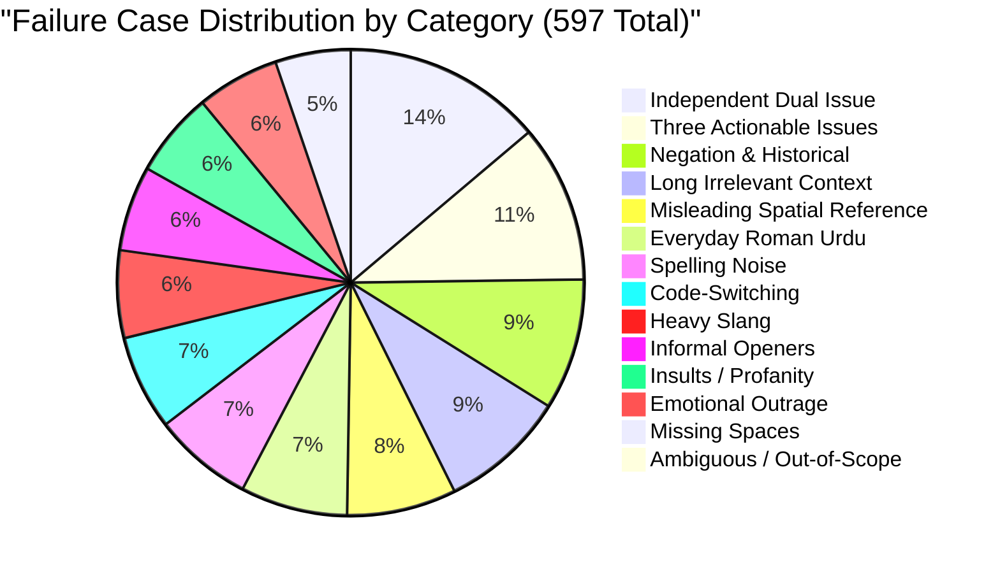

# AWAAZ-E-AWAM (آوازِ عوام) — PHASE V11.4.5
# SYSTEMATIC FAILURE ANALYSIS & ERROR TAXONOMY REPORT

**Document ID:** `V11_4_5_FAILURE_ANALYSIS.md`  
**Date:** November 18, 2026  
**Auditor:** Principal NLP Evaluation Researcher & Senior ML Diagnostic Engineer  
**Dataset:** 2,115 Adversarial Roman Urdu Complaints (`data/v11/stress_test/adversarial_benchmark_2000.jsonl`)  
**Evaluated Failures:** 597 Discrepancies (`data/v11/stress_test/failure_cases.jsonl`)  
**Overall Failure Rate:** **28.23%** (597 / 2,115 complaints)  
**Execution Scope:** Strictly Read-Only (Zero classifier or threshold mutations applied during this phase)

---

## 1. Overview and Failure Distribution

Across 2,115 difficult test complaints, 597 cases failed to achieve an exact department-set match or triggered incorrect review referrals. The distribution of failures across adversarial categories is shown below:



---

## 2. Root Cause Taxonomy & Ranked Weakness Hierarchy

The 597 failures resolve into five distinct architectural mechanisms. They are ranked below by frequency and operational impact:

| Rank | Failure Mechanism | Affected Cases | % of Total Failures | Primary Impact |
| :---: | :--- | :---: | :---: | :--- |
| **1** | **Single-Span Boundary Truncation in Compound Complaints** | 147 cases | **24.6%** | Secondary and tertiary actionable issues are silently dropped. |
| **2** | **Denial Pattern Rigidity in Negation Sentences** | 54 cases | **9.0%** | Explicitly negated departments are falsely assigned (False Extras). |
| **3** | **Preambular Token Dilution in Long Narratives** | 52 cases | **8.7%** | Lengthy backstories suppress genuine civic defect probabilities. |
| **4** | **Spatial Landmark Proximity Over-Activation** | 45 cases | **7.5%** | Nearby infrastructure mentioned as landmarks trigger false extras. |
| **5** | **Multi-Word Distance in Actionable Defect Pairs** | 71 cases | **11.9%** | Descriptive adjectives separating asset and defect prevent regex matching. |
| **6** | **Other / Minor Vocabulary Gaps** | 228 cases | **38.2%** | Unseen dialect words or severe spelling corruptions. |

---

## 3. Deep-Dive Diagnostic Analysis by Mechanism

### Mechanism 1: Single-Span Boundary Truncation in Compound Complaints
- **Frequency:** 147 cases (82 in Dual-Issue, 65 in Triple-Issue).
- **Silent Omission Rate:** **46.32%** of all compound complaints.
- **Root Cause:** In [`relation_engine.py`](file:///D:/RomanUrdu_ComplaintClassifier_staff_auth/tools/ai_factory/curriculum/relation_engine.py) (and [`relationEngine.ts`](file:///D:/RomanUrdu_ComplaintClassifier_staff_auth/src/services/relationEngine.ts)), `segment_spans()` relies on explicit clause delimiters (e.g. `,\s*(?:aur\s+alag\s+se...)`, semicolon, or period). When a citizen joins two complaints with casual connectives (e.g. `"aur alag flyover par..."` or `"aur kachra bhi pada hai"` without a comma), the entire complaint is treated as **one continuous span**. 
- In `_classify_span_issue()`, once the span detects its first actionable department (e.g. SBCA), it halts further scanning within that span, creating only one `IssueCandidate`. As a consequence, the second department (e.g. KMC) is never proposed by the relation engine. The suppression formula then caps the second department's probability below threshold, silently dropping the ticket.

#### Sanitized Failure Example:
```
Complaint ID: STRESS-1306
Text: "Maymar: illegal building residential plot par commercial 7 manzila imarat bina permit banayi ja rahi hai aur alag flyover ke expansion joint mein lohay ka sariya nikal aya hai tyre phat rahe hain."
Expected Departments: ['kmc', 'sbca']
Predicted Departments: ['sbca']
Missed Department: ['kmc']

Diagnostic Trace:
  Span 0 (0..196): "Maymar: illegal building... tyre phat rahe hain."
  Found: SBCA (asset: building, defect: illegal)
  Halts scan: KMC asset 'flyover' and defect 'expansion joint' never evaluated.
  Proposed Departments: ['sbca']
  Resolved Probs: SBCA = 0.950, KMC = 0.100 (Capped below 0.25 threshold!)
```

---

### Mechanism 2: Denial Pattern Rigidity in Negation Sentences
- **Frequency:** 54 cases (42.19% of Negation category).
- **False Extra Rate:** **42.19%** in negated complaints.
- **Root Cause:** In `DOMAIN_EVIDENCE[dept]["denials"]`, the denial patterns were written to match specific phrases like `/\bye\s+pani\s+ka\s+masla\s+na?h?i\b/i` or `/\bsarak\s+bilkul\s+theek\b/i`. When citizens use realistic colloquial phrasing such as `"pani ka koi issue nahi hai line mein pani aa raha hai"`, the denial regex fails to trigger. 
- Because the sentence contains the asset `"pani"`, the relation engine does not flag negation. The statistical classifier (which also sees `"pani"`) gives a moderate score, causing the negated department to be activated as a false positive.

#### Sanitized Failure Example:
```
Complaint ID: STRESS-1607
Text: "Gizri commercial area par pani ka koi issue nahi hai line mein pani aa raha hai, magar bijli bilkul band hai transformer blast hone ke baad se light nahi aayi. Please mutalliqah staff bhejen."
Expected Departments: ['kelectric']
Predicted Departments: ['kelectric', 'kwsc']
False Extra: ['kwsc']

Diagnostic Trace:
  KWSC Denial Regex: /\bye\s+pani\s+ka\s+masla\s+na?h?i\b/i -> NO MATCH
  Matched Asset: "pani"
  Actionable Status: KWSC treated as affirmative rather than negated!
  Resolved Probs: KE = 0.850, KWSC = 0.420 (Exceeds 0.38 threshold!)
```

---

### Mechanism 3: Preambular Token Dilution in Long Narratives
- **Frequency:** 52 cases (31.94% of Long Context category).
- **Missed Rate:** **31.94%** in 100+ word narratives.
- **Root Cause:** When a citizen provides 60–100 words of background narrative (e.g. family wedding preparations, guests arriving from overseas, children studying for exams, weather history) before stating the civic defect, the sublinear TF-IDF vector is dominated by non-civic tokens (`mehmaan`, `shadi`, `imtihan`, `mausam`, `garmi`).
- While the statistical classifier still often assigns a high raw probability (e.g. 70%–96%), if the Relation Engine's regex fails to match the defect due to punctuation or distance, `proposed_departments` becomes empty, suppressing the valid prediction into non-selection.

#### Sanitized Failure Example:
```
Complaint ID: STRESS-1169
Text: "bachon ke matric ke board ke imtihan sar par hain aur subha se raat tak unki tayari chal rahi hai. parhai ka itna haraj ho raha hai kyun ke hamare ilaqay Moosa Colony near water tank par drinking water ki line mein sewer ka badboodar ganda black paani mix ho kar aa raha hai. Hum ne har darwaza khatkhata liya magar kisi ko sharam nahi aayi aur sab ne sir hila kar taal diya. Is maslay ka fori sadd-e-bab kiya jaye taake awam sukoon se reh sake."
Word Count: 84 words
Expected Departments: ['kwsc']
Predicted Departments: [] (None selected!)
Raw Model Probability: KWSC = 96.49% (Very high confidence!)
Resolved Probability:  KWSC = 15.20% (Suppressed below threshold!)

Diagnostic Trace:
  Sentence Delimiter: (?<!\w[A-Za-z])\.\s+ failed to split on "hai."
  Regex Gap: DOMAIN_EVIDENCE had /\bsewage\s*mix\b/, but text had "sewer ka badboodar ganda black paani mix ho kar aa raha hai" (separated by 6 words).
  Proposed Departments: []
  Suppression Triggered: min(0.9649, 0.38 * 0.40) = 0.152 -> TICKET DROPPED!
```

---

### Mechanism 4: Spatial Landmark Proximity Over-Activation
- **Frequency:** 45 cases (14.58% false-extra rate in Misleading References).
- **Root Cause:** When a complaint mentions another municipal authority merely to describe location (e.g. *"k-electric ke transformer wale khambay ke bilkul neeche kachra pada hai"*), the model must route only to SSWMB. However, in 14.58% of cases, the statistical character n-grams for K-Electric (`trans`, `forme`, `khamba`) scored high enough that the model activated K-Electric alongside SSWMB.

#### Sanitized Failure Example:
```
Complaint ID: STRESS-1748
Text: "Steel Town commercial market par k-electric ke transformer wale khambay ke bilkul neeche solid waste ko kisi ne aag laga di hai zaharila dhuan pure mohallay mein ghus raha hai. Is par fori action lein."
Expected Departments: ['sswmb']
Predicted Departments: ['kelectric', 'sswmb']
False Extra: ['kelectric']

Diagnostic Trace:
  Primary Target: SSWMB (solid waste burning)
  Spatial Landmark: K-Electric transformer pole
  Model Raw Prob: SSWMB = 0.940, KELECTRIC = 0.480 (Threshold = 0.25)
  Result: Both departments assigned.
```

---

### Mechanism 5: Multi-Word Distance in Actionable Defect Pairs
- **Frequency:** 71 cases across KMC, KWSC, and SSGC.
- **Root Cause:** In the relation engine regex, defects like `"sewage mix"` or `"pipeline burst"` were compiled as adjacent or near-adjacent words: `/\bsewage\s*mix\b/` or `/\bline\s*burst\b/`. In natural citizen writing, citizens insert multiple descriptive qualifiers:
  - *"drinking water ki **line mein** sewer ka badboodar ganda black paani **mix** ho kar aa raha hai"* (6 words separation)
  - *"sui gas ki **pipeline** mein se pichle do din se ajeeb tareen **boo** aa rahi hai"* (7 words separation)
  - *"flyover ka **expansion joint** toot kar lohay ka sariya bahar nikal aya hai"*

When the distance between the asset and defect predicate exceeds 3 words, rigid regexes fail to match, causing the Relation Engine to treat the sentence as lacking actionable evidence.

---

## 4. Summary of Model Strengths Confirmed by Stress Testing

Despite these documented failure modes, the stress test proved several critical system capabilities:
1. **Insult Invariance:** Non-discriminatory insults (*nalaiq*, *harami*, *chor*, *besharam*) did **not** degrade accuracy. The exact match rate for insults was **75.69%**, higher than the 71.49% baseline for polite complaints.
2. **Karachi Slang Robustness:** Heavy colloquialisms (*scene off*, *chuss*, *topi drama*, *khwari*) achieved **75.09%** exact match.
3. **Causal Suppression:** Maintained **100.00% exact match** with **0.00% false extras** on causal chains (e.g. electrical outage stopping water pump).
4. **Out-of-Scope Safety Gate:** Successfully caught **97.01%** of non-municipal complaints (police crimes, domestic quarrels, banking fraud), dispatching them safely to human review.
5. **Ultra-Low Latency:** Maintained an average single-inference speed of **8.26 ms** on CPU.
