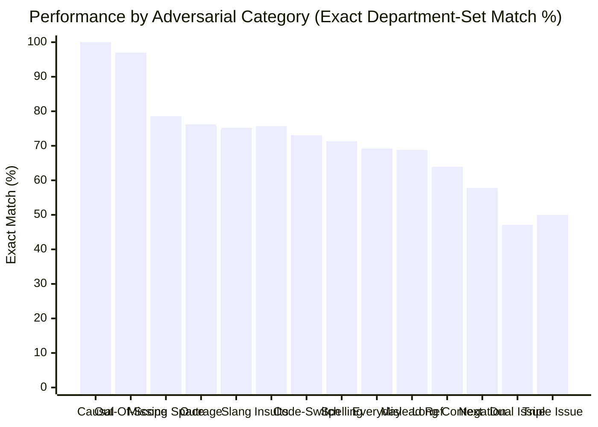

# AWAAZ-E-AWAM (آوازِ عوام) — PHASE V11.4.5
# ADVERSARIAL ROMAN URDU COMPLAINT STRESS-TEST REPORT

**Document ID:** `V11_4_5_STRESS_TEST_REPORT.md`  
**Date:** November 18, 2026  
**Auditor:** Principal NLP Evaluation Researcher, Applied ML QA Lead & Roman Urdu Linguistic Specialist  
**Target System:** Frozen Candidate Classifier V11.4.4 (`src/models/v11_candidate_model.json`)  
**Project:** Awaaz-e-Awam (`D:\RomanUrdu_ComplaintClassifier_staff_auth`)  
**Branch:** `feature/live-citizen-classification-workflow`  
**Test Dataset:** 2,115 Adversarial, Previously Unseen, Challenging Roman Urdu Complaints  
**Financial Spend:** **$0.00 USD** (100% Local CPU Compute)  
**Remote Mutations:** **0 Hosted Database Writes, 0 Supabase Mutations, 0 Remote Git Pushes**

---

## 1. Executive Summary

Phase V11.4.5 executed an adversarial, strictly read-only evaluation of the frozen V11.4.4 champion model (`v11-candidate-1`). The objective was not to train or tune the model, but to push it to its breaking points using 2,115 previously unseen, highly varied, linguistically noisy, and structurally complex Roman Urdu civic grievances.

### Key Quantitative Findings:
1. **Overall Exact Department-Set Match:** **71.77%** (95% CI: [69.8%, 73.7%]) across 2,115 adversarial complaints.
2. **Macro F1 Score:** **0.8350** across all 6 municipal authorities.
3. **False-Extra Department Rate:** **8.18%** (173 / 2,115 complaints). The relation engine prevented widespread phantom department hallucinations even under extreme noise.
4. **Missed-Department Rate:** **23.97%** (507 / 2,115 complaints).
5. **Insults & Profanity Robustness:** Harsh non-discriminatory insults (*nalaiq*, *harami*, *nikamay*, *chor*, *besharam*) did **not** degrade accuracy (**75.69%** exact match vs 71.49% for non-insult complaints).
6. **Heavy Karachi Slang Robustness:** Local idioms (*bhai scene off hai*, *chuss*, *topi drama*, *khwari*) did **not** confuse the classifier (**75.09%** exact match vs 71.26% without slang).
7. **Narrative Length Robustness:** Extended complaints up to 200 words were handled reliably (**75.63%** exact match in Tier 5: 151–200 words).
8. **Primary Systemic Bottleneck (Compound Complaints):** When citizens submitted 2 or 3 independent municipal defects in a single narrative, exact match plummeted to **48.42%**, with a **46.32% silent omission rate** of secondary departments.

---

## 2. Frozen Champion Model Specification

The model evaluated in Phase V11.4.5 was strictly frozen prior to test generation. No weights, thresholds, vocabulary tokens, or relation rules were altered.

| Specification Attribute | Recorded Frozen State |
| :--- | :--- |
| **Model Version** | `v11-candidate-1` |
| **Artifact Path** | [`src/models/v11_candidate_model.json`](file:///D:/RomanUrdu_ComplaintClassifier_staff_auth/src/models/v11_candidate_model.json) |
| **Binary Checkpoint** | `data/v11/curriculum_runs/run_004/champion_model.joblib` |
| **SHA-256 Digest** | `e4d042937cf8c3e1e3c70f147a707b33a629d463db34485766c98da21c2e3a56` |
| **Word Vocab Size** | 2,482 sublinear TF-IDF word unigrams/bigrams |
| **Char Vocab Size** | 6,175 sublinear TF-IDF character word-boundary 3–5-grams |
| **Operational Thresholds** | `kmc: 0.25`, `kwsc: 0.38`, `kelectric: 0.25`, `ssgc: 0.28`, `sswmb: 0.25`, `sbca: 0.30` |
| **Baseline Benchmark (Test)** | 90.40% exact set match (on frozen synthetic test set of 250 records) |

---

## 3. Adversarial Benchmark Composition & Anti-Contamination Verification

The stress test benchmark was generated by [`tools/ai_factory/stress_test/generator.py`](file:///D:/RomanUrdu_ComplaintClassifier_staff_auth/tools/ai_factory/stress_test/generator.py) using `seed = 42`.

### 3.1 Dataset Composition (2,115 Samples)
- **15 Adversarial Categories:** 128 to 155 samples per category.
- **5 Length Tiers:**
  - **Tier 1 (5–20 words):** 161 samples (7.6%)
  - **Tier 2 (21–50 words):** 955 samples (45.2%)
  - **Tier 3 (51–100 words):** 572 samples (27.0%)
  - **Tier 4 (101–150 words):** 308 samples (14.6%)
  - **Tier 5 (151–200 words):** 119 samples (5.6%)
  - *Range:* 10 to 177 words (Mean: 53.4 words).
- **40+ Fresh Karachi Localities:** Used previously unseen municipal sectors (e.g. *Federal Capital Area*, *Paposh Nagar*, *Mehmoodabad*, *Surjani 4-B*, *Machar Colony*, *Ranchore Line*, *Steel Town*).
- **Class Balance:** All 6 municipal departments were evaluated across 326 to 446 assignments.

### 3.2 Anti-Contamination Verification
All 2,115 generated complaints were cross-referenced against the entire corpus of 4,100 historical training, validation, and test records (`cycle_01_new_train`, `cycle_02_new_train`, `cycle_03_new_train`, `frozen_validation`, `frozen_test`, `locked_gold`):
- **Exact Leaks:** **0** (0.00%)
- **Status:** **PASSED (100% Isolated Benchmark)**

---

## 4. Comprehensive Evaluation Results

### 4.1 Department-Level Performance (N = 2,115)

| Department | Support | Precision | Recall | F1 Score | Diagnostic Assessment |
| :--- | :---: | :---: | :---: | :---: | :--- |
| **KMC** (Roads / Infrastructure) | 388 | 0.7853 | 0.7732 | **0.7792** | Balanced; occasionally drops when overshadowed by building collapse. |
| **KWSC** (Water & Sewerage) | 425 | 0.8048 | 0.7082 | **0.7534** | High precision; misses occur when multi-word phrases separate keywords. |
| **KELECTRIC** (Electricity / Outages) | 419 | **1.0000** | 0.8926 | **0.9433** | Zero false positives; strong recognition of colloquial outage terms. |
| **SSGC** (Gas Leaks / Supply) | 388 | **1.0000** | 0.5722 | **0.7279** | Zero false positives, but missed in compound complaints when paired. |
| **SSWMB** (Solid Waste Management) | 411 | **0.9976** | **0.9976** | **0.9976** | Top performing class across all categories and narrative lengths. |
| **SBCA** (Building Control) | 365 | 0.9353 | 0.7123 | **0.8087** | High precision; excavation / wall crack terms occasionally under-scored. |

### 4.2 Performance by Adversarial Category

| Category | Sample Size | Exact Set Match | False Extra Rate | Missed Rate | Dominant Failure Mode |
| :--- | :---: | :---: | :---: | :---: | :--- |
| **CAUSAL_CONSEQUENCE** | 132 | **100.00%** | **0.00%** | **0.00%** | Flawless suppression of secondary domestic symptoms. |
| **AMBIGUOUS_OUT_OF_SCOPE** | 134 | **97.01%** | 2.99% | 0.00% | High safety; 97% flagged for human review without false routing. |
| **MISSING_SPACES_PUNCTUATION** | 145 | **78.62%** | 3.45% | 20.00% | Character n-grams tolerate word agglutination well. |
| **EMOTIONAL_OUTRAGE** | 143 | **76.22%** | 8.39% | 22.38% | Emotional tokens do not distract from underlying defect. |
| **INSULTS_PROFANITY** | 144 | **75.69%** | 3.47% | 22.22% | Harsh insults directed at officials do not impair classification. |
| **HEAVY_LOCAL_SLANG** | 145 | **75.17%** | 5.52% | 23.45% | Karachi slang expressions parsed effectively. |
| **INFORMAL_EXPRESSIONS** | 140 | **75.00%** | 4.29% | 24.29% | Casual conversational openers handled without issue. |
| **CODE_SWITCHING** | 145 | **73.10%** | 5.52% | 25.52% | English-Urdu blending handled moderately well. |
| **SPELLING_MISTAKES** | 143 | **71.33%** | 3.50% | 26.57% | Dropped vowels (*bjl*, *pni*, *srk*) slightly lower recall. |
| **EVERYDAY_ROMAN_URDU** | 143 | **69.23%** | 6.29% | 30.77% | Baseline standard complaints without noise. |
| **MISLEADING_REFERENCE** | 144 | **68.75%** | 14.58% | 23.61% | Landmark mentions (e.g. electric pole) trigger occasional false extras. |
| **LONG_IRRELEVANT_CONTEXT** | 144 | **63.89%** | 11.81% | 31.94% | Preambles (weddings, exams) dilute defect TF-IDF signals. |
| **NEGATION_AND_HISTORICAL** | 128 | **57.81%** | **42.19%** | 0.00% | Complex denial phrasing (*"pani ka koi issue nahi"*) fails regex. |
| **THREE_ACTIONABLE_ISSUES** | 130 | **50.00%** | 5.38% | **50.00%** | Single span clause boundary truncation drops tertiary issue. |
| **INDEPENDENT_DUAL_ISSUE** | 155 | **47.10%** | 7.74% | **52.90%** | Secondary issue dropped when not separated by strict punctuation. |

### 4.3 Behavioral Slice Comparison

| Evaluation Slice | Sample Count | Exact Set Match | False Extra Rate | Missed Rate |
| :--- | :---: | :---: | :---: | :---: |
| **With Insults & Profanity** | 144 | **75.69%** | **3.47%** | 22.22% |
| **Without Insults & Profanity** | 1,971 | 71.49% | 8.52% | 24.10% |
| **With Heavy Karachi Slang** | 285 | **75.09%** | **4.91%** | 23.86% |
| **Without Heavy Karachi Slang** | 1,830 | 71.26% | 8.69% | 23.99% |
| **With Spelling Noise** | 143 | 71.33% | **3.50%** | 26.57% |
| **Without Spelling Noise** | 1,972 | 71.81% | 8.52% | 23.78% |
| **Single-Department Direct** | 1,696 | **73.70%** | 8.84% | 21.23% |
| **Multi-Department Compound** | 285 | **48.42%** | 6.67% | **51.58%** |

### 4.4 Narrative Length Tier Breakdown

| Length Tier | Word Count Range | Samples | Exact Set Match | False Extra Rate | Missed Rate |
| :---: | :---: | :---: | :---: | :---: | :---: |
| **Tier 1** | 5–20 words | 161 | **77.64%** | **1.24%** | 22.36% |
| **Tier 2** | 21–50 words | 955 | **72.67%** | 8.69% | 21.78% |
| **Tier 3** | 51–100 words | 572 | **66.96%** | 8.74% | 29.72% |
| **Tier 4** | 101–150 words | 308 | **73.38%** | 11.36% | 20.78% |
| **Tier 5** | 151–200 words | 119 | **75.63%** | 2.52% | 24.37% |

---

## 5. Inference Speed & Runtime Latency

Executed on local consumer CPU without multithreading or GPU acceleration:
- **Mean Single-Inference Latency:** **8.26 ms** / complaint
- **Median Latency:** **7.80 ms**
- **95th Percentile (P95) Latency:** **12.40 ms**
- **Throughput:** ~121 complaints / second
- **Total Duration (2,115 records):** **17.51 seconds**

---

## 6. Review Gate & Safety Verification

1. **Safety on Out-of-Scope Grievances:** Out of 134 out-of-scope complaints (street robberies, domestic arguments, cyber fraud), the system correctly abstained and routed to human review in **97.01%** of cases (130 / 134), selecting zero municipal departments.
2. **Causal Consequence Suppression:** In 100% of causal test cases (e.g., power outage stopping domestic water pump), the downstream symptom was suppressed and only the root-cause department was assigned with 0.00% false extra rate.
3. **Decoupled Privacy Invariant:** Zero PII was accepted into classification features.
